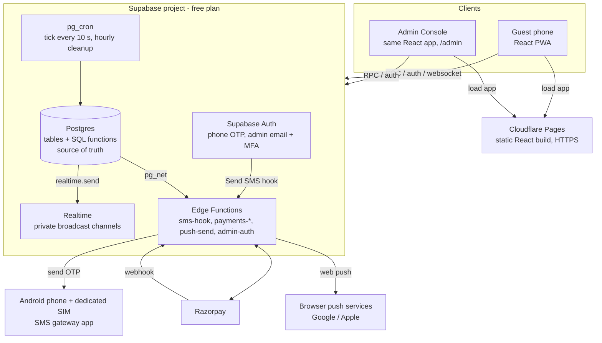
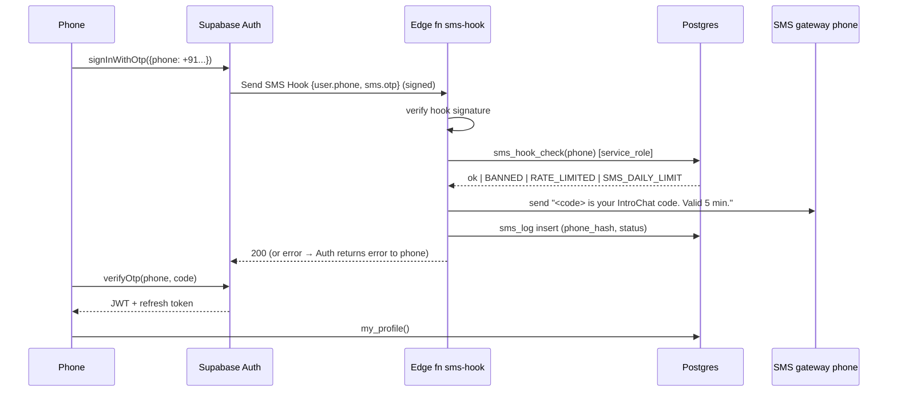
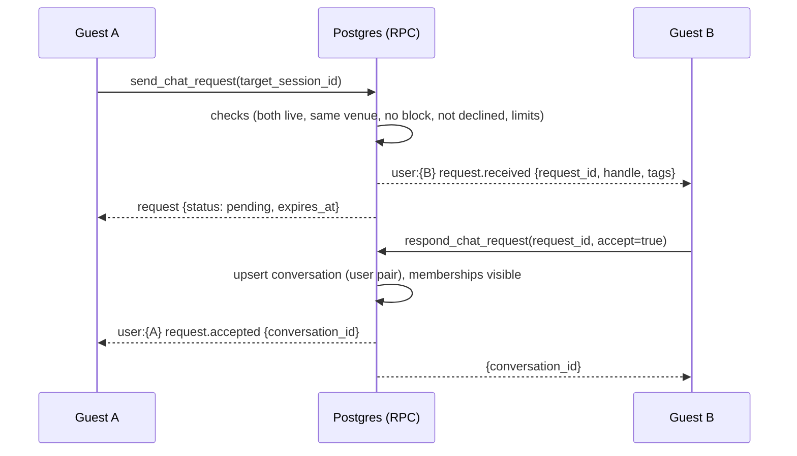
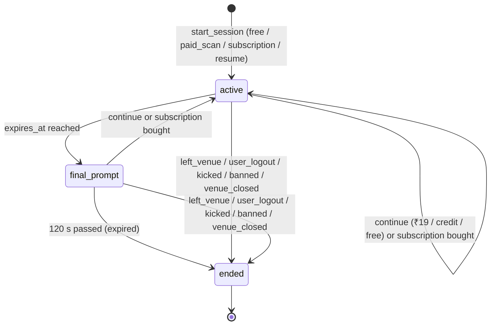
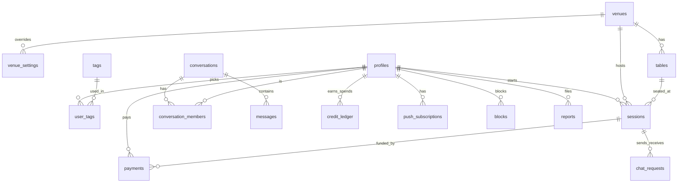

# IntroChat — Architecture, Data Flow & Database Schema (V1)

> **Audience:** developers building IntroChat V1.
> **Date:** 2026-10-10 · **Status:** V1 final draft, waiting for approval
> **Related:** [IDEA_AND_TECH_STACK.md](IDEA_AND_TECH_STACK.md) (what & why) · [IMPLEMENTATION_PLAN.md](IMPLEMENTATION_PLAN.md) (milestones)
> Diagrams use Mermaid (render on GitHub; in VS Code install *"Markdown Preview Mermaid Support"*).

---

## Contents

1. [System architecture](#1-system-architecture)
2. [Cross-cutting rules](#2-cross-cutting-rules)
3. [Location (GPS) check](#3-location-gps-check)
4. [Data flows](#4-data-flows)
5. [State machines](#5-state-machines)
6. [Database schema](#6-database-schema)
7. [Realtime channels](#7-realtime-channels)
8. [Scheduled jobs (pg_cron)](#8-scheduled-jobs-pg_cron)
9. [Concurrency & consistency](#9-concurrency--consistency)
10. [Error codes](#10-error-codes)
11. [Data retention & privacy](#11-data-retention--privacy)
12. [Limits & scaling path](#12-limits--scaling-path)

---

## 1. System architecture

### 1.1 Components



### 1.2 Responsibilities

| Component | Owns | Does NOT do |
|---|---|---|
| **React app** | UI, i18n (en/hi/gu), countdown display, location readings, heartbeat, Realtime subscriptions, Razorpay Checkout, push registration | Decide time, decide "inside", trust its own clock or prices |
| **Cloudflare Pages** | Serving the static build over HTTPS, SPA fallback | Any logic |
| **Supabase Auth** | Phone OTP (create + verify code), admin email/password + TOTP MFA, JWTs | Roles (admin role is our `admins` table), bans (our `bans` table + Auth ban) |
| **Postgres** | All data and **all business rules**, as `SECURITY DEFINER` SQL functions called by RPC | Calling external APIs except via `pg_net` to our own Edge Functions |
| **Realtime** | Delivering events to phones over one websocket per client | Storing anything |
| **pg_cron** | Timed rules: warnings, expiry, final prompt, 3-min away grace, offline marking, request expiry, cleanup | — |
| **Edge Functions** | Anything that needs a secret or an outside HTTP call: SMS hook, Razorpay, Web Push, Auth admin calls | Business rules (they call SQL functions for that) |
| **SMS gateway phone** | Sending the OTP SMS from the dedicated SIM | — |
| **Razorpay** | Taking payments, sending webhooks | — |

### 1.3 Environments

| Environment | Supabase | Frontend | Used for |
|---|---|---|---|
| **dev** | Free project #1 | `dev` branch → Cloudflare preview URL | Development, automated tests (Supabase test phone numbers, Razorpay test mode) |
| **prod** | Free project #2 | `main` → `<name>.pages.dev` (own domain later) | Pilot |

No local Docker. Developers run the React app locally (`npm run dev`) against the **dev** Supabase project. Database changes are SQL migration files pushed with the Supabase CLI.

### 1.4 Trust boundaries

```
 UNTRUSTED                               TRUSTED
 ──────────────────────────────┬─────────────────────────────────────────────
 Phone browser (any input,      │ Postgres functions, pg_cron, Edge Functions
 any clock, any location value) │
                                │ Trust rules:
                                │  • Identity  = Supabase JWT (auth.uid())
                                │  • Admin     = row in admins + JWT aal = 'aal2' (MFA done)
                                │  • Time      = Postgres now() only
                                │  • Inside    = server-side evaluation of the reading (§3)
                                │  • Prices    = app_settings / venue_settings, never the client
                                │  • Payment   = Razorpay signature verified in an Edge Function
```

---

## 2. Cross-cutting rules

### 2.1 Access model: RPC only

- **Every table has Row Level Security ON and no policies for `anon` / `authenticated`.** Clients cannot read or write any table directly.
- Clients call **SQL functions** through `supabase.rpc(...)`. Each function is `SECURITY DEFINER`, has `SET search_path = ''`, uses fully-qualified names, checks `auth.uid()` itself, and returns only safe fields.
- Functions callable by guests are granted to `authenticated` (and `location_check` / `venue_public` also to `anon`). Admin functions check `is_admin()` first. Service-only functions (`apply_payment`, `sms_hook_check`, ...) are granted **only** to `service_role`.
- A pgTAP test asserts that `anon` and `authenticated` cannot `SELECT/INSERT/UPDATE/DELETE` any table (§ Testing in the plan).

### 2.2 Authentication

**Guests — phone OTP:**
- Supabase Auth phone provider, OTP length 6, expiry 300 s. Only `+91` numbers accepted in V1.
- The **Send SMS Hook** points to Edge Function `sms-hook`. Supabase Auth generates the code; our hook only delivers it (§4.2).
- On first sign-in a trigger on `auth.users` creates the `profiles` row (handle, phone_hash).
- Sessions persist on the phone (Supabase refresh tokens), so a returning guest on the same phone does not need a new OTP.

**Admins — email + password + TOTP MFA:**
- Created only by another admin, through the Admin API / dashboard. Public email sign-up is refused by the **before-user-created hook** (`before_user_created_hook`), not by the email sign-up switch: switching that off also disables email *sign-in* (found in M2). The hook does not run for Admin-API-created users, so admins are unaffected. The same hook refuses phone sign-ups that are not +91 mobiles or are banned.
- Auth settings are code: `supabase/config.toml`, applied with `npx supabase config push` after `config pull` + `config diff`. Dev-only values (test phone numbers, the Send SMS hook URL) live in `[remotes.dev]`; secrets come from the git-ignored `supabase/.env`.
- `is_admin()` = `EXISTS (admins where user_id = auth.uid() and is_active) AND auth.jwt()->>'aal' = 'aal2'`.

### 2.3 Settings resolution (the payment switches and all tunables)

```sql
-- venue override ?? global value
create function setting(p_key text, p_venue uuid default null) returns jsonb ...
  select coalesce(
    (select value from venue_settings where venue_id = p_venue and key = p_key),
    (select value from app_settings  where key = p_key));
```

- `app_settings` holds every global default (full list in the implementation plan §4). `venue_settings` holds per-restaurant overrides.
- Both are edited only from the Admin Console; every change goes to `audit_log`.
- `PAYMENTS_ENABLED = false` forces scan fee and subscription off regardless of the other switches: `scan_fee_on(v) = setting('PAYMENTS_ENABLED', v) AND setting('SCAN_FEE_ENABLED', v)` (same for subscription).
- Secrets (Razorpay keys, webhook secret, SMS gateway credentials, VAPID private key, hook secret) live in **Edge Function secrets**. The phone-hash key lives in **Supabase Vault**. None are in `app_settings`.

### 2.4 Time, money, IDs, text

| Concern | Rule |
|---|---|
| Time | `timestamptz`, server `now()` only. Every session payload includes `server_now`; the phone computes `offset = server_now − Date.now()` for the countdown. |
| Local dates | Stats and "close for today" use the venue's `timezone` (default `Asia/Kolkata`). |
| Money | Integer **paise** (`₹19 = 1900`, `₹400 = 40000`). No floats. |
| IDs | `uuid` (`gen_random_uuid()`) for entities; `bigint generated always as identity` for messages, ledger, audit. |
| Text | UTF-8. Chat body 1..1000 chars after trim; whitespace-only rejected. |
| Enums | `text` + `CHECK` (easy to migrate). |

### 2.5 Errors are codes

Functions raise `RAISE EXCEPTION USING MESSAGE = '<CODE>', DETAIL = '<json>'`. Edge Functions return `{ "code": "...", "details": {...} }`. The app translates with `t('errors.<CODE>')` into en/hi/gu. Full list in §10.

### 2.6 Rate limits

Fixed-window counters in table `rate_limits(key, window_start, count)`, checked inside the functions:

| Key | Limit |
|---|---|
| `location_check` per device_id | 30 / min |
| OTP per phone (in `sms-hook`) | 5 / hour |
| OTP global per day (SIM cap) | `SMS_DAILY_CAP` (default 90); alert admins at `SMS_ALERT_AT` (70) |
| `start_session` per user | 10 / hour |
| `heartbeat` per session | 6 / min |
| chat requests per session | 20 / hour, max 5 pending outgoing |
| messages per session | 20 / 10 s |
| payments created per user | 10 / hour |
| reports per user | 5 / day |

Exceeding → `RATE_LIMITED` with `retry_after` seconds.

---

## 3. Location (GPS) check

### 3.1 On the phone

```ts
navigator.geolocation.getCurrentPosition(onFix, onError, {
  enableHighAccuracy: true, timeout: 15000, maximumAge: 10000,
});
// reading = { lat, lng, accuracy_m, age_s = (Date.now() - position.timestamp) / 1000 }
// The age is measured on the phone, against the phone's own clock, so a phone
// whose clock is wrong still reports a correct age (built in M1, migration 0002).
```

- A reading is taken: on the landing page, right before `start_session`, **every `LOCATION_INTERVAL_SECONDS` (120)** while the page is visible, and immediately on `visibilitychange → visible`.
- The latest reading rides along with each heartbeat (every 30 s). The server evaluates only readings newer than the last one it evaluated.
- Permission state is sent too (`granted | denied | prompt`). Denied mid-session counts as **outside**.

### 3.2 On the server — `evaluate_location(venue, reading) → inside | outside | unknown`

```
d   = haversine(venue.lat, venue.lng, reading.lat, reading.lng)   -- metres
R   = setting('GEOFENCE_RADIUS_M', venue)        -- default 40
MAX = setting('MAX_ACCURACY_M', venue)           -- default 60
BUF = setting('ACCURACY_BUFFER_M', venue)        -- default 15
acc = reading.accuracy_m

if reading.age_s > MAX_LOCATION_AGE_SECONDS (120)             → unknown
if acc > MAX                                                   → unknown
if d <= R + min(acc, BUF)                                      → inside
if d - acc > R                                                 → outside   (outside even at best)
else                                                           → unknown
```

Haversine is a small SQL function (`earth radius 6371000 m`). No PostGIS needed.

### 3.3 Rules

| Moment | Rule |
|---|---|
| `location_check` (landing) | Returns the result only, for the UI. Not trusted for anything. |
| `prepare_payment` (scan fee / subscription at entry) | Requires **inside**, so nobody pays from home and then fails. |
| `start_session` | Requires **inside**. `unknown` → `LOCATION_INACCURATE`; `outside` → `NOT_AT_VENUE`. |
| Heartbeat, **inside** | Clear `away_since`. |
| Heartbeat, **outside** | Set `away_since = now()` if null. |
| Heartbeat, **unknown** | No change. |
| Heartbeat after being **offline** (no heartbeat for > 90 s) and the first reading is **outside** | `end_session('left_venue')` immediately. |
| pg_cron tick | `away_since < now() − AWAY_GRACE_SECONDS (180)` → `end_session('left_venue')`. |

### 3.4 Spoof signals (flag only, never auto-ban)

Checked in `heartbeat`, appended to `sessions.spoof_flags` for admin review:
- speed between two consecutive readings > `MAX_SPEED_MPS` (50 m/s)
- the exact same lat/lng repeated ≥ 5 readings in a row (real GPS always moves slightly)
- `accuracy_m = 0`

The previous reading (`last_lat`, `last_lng`, `last_taken_at`) is stored on the live session only for these checks and **wiped by `end_session`**.

### 3.5 Venue pin setup (Admin Console)

- Map (Leaflet + OSM) with address search (Nominatim) → drag the pin, set radius (25–300 m), max accuracy.
- **"Set pin from my phone here"**: on-site, the admin's phone takes readings for 30 s; the app averages readings with accuracy ≤ 30 m and proposes that point.
- **"Test"**: live display of distance, accuracy and the inside/outside/unknown result, so the admin can walk to the door and see the boundary.

---

## 4. Data flows

Each flow: **trigger → steps → writes → events → failures.**

### 4.1 QR scan → landing → location check

```mermaid
sequenceDiagram
  participant P as Phone
  participant DB as Postgres (RPC)
  P->>DB: venue_public(slug, qr_token)
  DB-->>P: name, logo, table_label, flags (payments on?, prices)
  P->>P: language picker, "why location" card with a "Check my location" button
  Note over P: the browser's permission prompt appears only after that tap;<br/>if permission was already granted, the check starts on its own
  P->>P: getCurrentPosition()
  P->>DB: location_check(slug, reading, device_id)
  DB-->>P: inside | outside | unknown (verdict only: no distance, so the pin cannot be triangulated)
  P->>P: inside → "Continue" unlocks
```

Logic:
1. Unknown slug or `is_active = false` → `VENUE_NOT_FOUND` ("This QR code is not active").
2. `venues.closed_until > now()` → `VENUE_CLOSED`.
3. Unknown / inactive `qr_token` → `TABLE_NOT_FOUND` ("Ask staff for a new QR"). Table is required in V1.
4. Permission denied → help screen per platform (iPhone Safari, iPhone Precise Location, Android Chrome).
5. `unknown` → "Location not precise enough — move near a window / turn on Precise Location, then retry".
6. `slug` and `qr_token` are kept in `sessionStorage` to survive the login step.

### 4.2 Login: phone OTP through the SIM gateway



- `sms_hook_check` *(built, M2)*: not a +91 mobile → `PHONE_NOT_ALLOWED`; platform ban on `phone_hash` → `BANNED` (no SMS spent); per-phone `OTP_PER_PHONE_PER_HOUR` → `RATE_LIMITED`; daily count (IST day) ≥ `SMS_DAILY_CAP` → `SMS_DAILY_LIMIT` + `sms.cap_reached` audit row; `SMS_ALERT_AT` → `sms.cap_alert` audit row. Every attempt, allowed or refused, is a row in `sms_log` (never the code or number). Gateway outage → `SMS_SEND_FAILED`.
- **Hook answers** must be HTTP 200 with `{"error": {...}}` for Supabase Auth to pass the code to the phone; any non-200 answer becomes a generic error (verified in M2). SMS codes are valid 300 s (`auth.sms.otp_expiry`; the platform default is 60 s).
- `SMS_PROVIDER` setting: `phone_gateway` (V1) | `twilio` (later; then the hook is disabled and Supabase's built-in Twilio provider is used).
- On first sign-in, trigger `on_auth_user_created` → insert `profiles(id = auth.users.id, phone_hash = hmac_sha256(vault_key, phone), handle = generate_handle())`. Admin (email) users get no profile.
- Handle: `<Word>-<4 digits>` from a curated word list; retry up to 5 times on unique conflict.
- Testing uses Supabase **test phone numbers** (fixed OTP, no SMS sent).

### 4.3 Onboarding (first time)

1. `accept_consent(version)` → `profiles.consent_at`, `consent_version`. The notice covers: phone number for login and safety, location used only to check presence, interests for matching, subscribers may keep chat history, report evidence kept 30 days.
2. `update_profile(birth_year, nickname?, gender?, preferred_language)` → `current_year − birth_year < MIN_AGE (18)` → `UNDER_AGE` (the profile is marked `age_blocked`, no session possible).
3. `tag_suggestions(slug, q)` → tags of guests live at this venue (most common first) + top global tags, prefix-filtered, blocked tags removed.
4. `set_tags(names[])` → normalise (NFC, trim, lower, collapse spaces, 1..24 chars, letters/digits/space in any script), unique, max `MAX_TAGS_PER_USER` (5), reject bad words / blocked → `TAG_NOT_ALLOWED`; replace `user_tags`; if live session → broadcast `person.updated` to the venue.

`profile_complete` = consent given AND birth_year set AND ≥ 1 tag AND not age_blocked.

### 4.4 Payment at entry (only if switches are on)

Shown when `start_session` would need payment: options **"₹19 – 1 hour"** and **"₹400 – 25 scans (2 hours each)"**. Flow in §4.10. After payment is applied, the phone calls `start_session(..., payment_id)`.

### 4.5 Start session — `start_session(slug, qr_token, reading, device_id, payment_id?)`

```
lock: SELECT profile FOR UPDATE
venue  = active venue by slug                       else VENUE_NOT_FOUND
         venue.closed_until <= now()                 else VENUE_CLOSED
table  = active table by (venue, qr_token)           else TABLE_NOT_FOUND
profile_complete                                     else PROFILE_INCOMPLETE / UNDER_AGE
no platform ban (user_id / phone_hash / device_id)   else BANNED
no venue ban (kick cooldown)                         else KICKED_COOLDOWN {until}
evaluate_location(venue, reading) = inside           else NOT_AT_VENUE / LOCATION_INACCURATE

live = live session of user (FOR UPDATE)
if live and live.venue_id = venue.id: return live                 -- refresh / reopen
if live: end_session(live, 'left_venue')                          -- moved to another venue

-- free resume of a paid session that ended early (decision 14)
prev = latest ended session of user at this venue
       where end_reason in ('left_venue','user_logout')
         and kind in ('paid_scan','subscription')
         and expires_at > now()
         and no session has resumed_from = prev.id
if prev: insert session(kind = prev.kind, expires_at = prev.expires_at,
                        block_started_at = prev.block_started_at, resumed_from = prev.id)
         → return

if not scan_fee_on(venue):
    kind = 'free';         minutes = FREE_SESSION_MINUTES (60)
elif profile.scan_credits > 0:
    kind = 'subscription'; minutes = SUBSCRIPTION_SESSION_MINUTES (120); ledger −1 ('session_start')
elif payment_id is a paid, unused payment of this user at this venue,
     purpose in ('scan_fee','continue'), paid_at > now() − UNUSED_FEE_VALID_MINUTES (30):
    kind = 'paid_scan';    minutes = SCAN_SESSION_MINUTES (60); payment.session_id = new session
else:
    raise PAYMENT_REQUIRED {scan_fee_paise, subscription_price_paise, subscription_on}

insert sessions(user, venue, table, kind, status='active', started_at=now(),
                block_started_at=now(), expires_at=now()+minutes, last_seen_at=now(),
                location_state='inside', start_distance_m, start_accuracy_m, device_id)
broadcast venue:{v}  person.joined {session_id, handle, tags}
return session payload + server_now
```

Uniqueness: partial unique index `uq_sessions_one_live_per_user`. If two tabs race, the loser catches the violation and returns the existing live session.

Note: if switches are on and the guest has scan credits, a scan **always uses a credit** (subscribers don't see the ₹19 option).

### 4.6 Heartbeat & presence — `heartbeat(reading?, permission_state)`

*Built (M3).* Every session function returns one shape, `session_state` (times, the rules the popups need, `server_now`). `my_session()` returns the live session or one ended in the last 30 minutes; `end_my_session()` is the guest's Leave / Log out. Until payments exist (M5), `start_session` refuses with `PAYMENT_REQUIRED` whenever the scan fee is on for the venue.

Every `HEARTBEAT_INTERVAL_SECONDS` (30) while visible, and immediately on becoming visible / back online.

```
s = live session of auth.uid() FOR UPDATE           else SESSION_NOT_ACTIVE
was_offline = s.is_offline
s.last_seen_at = now()
if permission_state = 'denied': state = 'outside'
elif reading is newer than s.location_checked_at: state = evaluate_location(...); spoof checks (§3.4)
else: state = null (nothing new)

if state = 'outside' and was_offline: end_session(s, 'left_venue'); return SESSION_ENDED
if state = 'outside' and s.away_since is null: s.away_since = now()
if state = 'inside': s.away_since = null
if was_offline: s.is_offline = false; broadcast venue person.online
return {status, kind, expires_at, final_deadline_at, away_since, credits, server_now}
```

- **Offline** (no heartbeat for `OFFLINE_AFTER_SECONDS` = 90) is set by the pg_cron tick and broadcast as `person.offline`. Offline is a flag, not a session status.
- There is **no inactivity logout**. A locked phone keeps its session until it expires.
- The client also subscribes to Realtime; a dropped websocket does not change presence.

### 4.7 People list — `get_people()`

```sql
select s.id as session_id, p.handle, s.is_offline,
       array_agg(t.name) filter (where t.id is not null and not t.is_blocked) as tags
from sessions s
join profiles p on p.id = s.user_id
left join user_tags ut on ut.user_id = p.id
left join tags t on t.id = ut.tag_id
where s.venue_id = :my_venue and s.status <> 'ended' and s.id <> :my_session
  and not exists (select 1 from blocks b
                  where (b.blocker_id = :me and b.blocked_id = p.id)
                     or (b.blocker_id = p.id and b.blocked_id = :me))
group by s.id, p.handle, s.is_offline, s.started_at;
```

In the same function: `shared_tags = my_tags ∩ tags`; `chat_state` per card = `none | request_sent | request_received | chatting | declined`; order by `(is_offline, −len(shared_tags), −started_at)`.

Card fields: `{session_id, handle, tags, shared_tags, online, chat_state}`. **Never** user_id, nickname, age, gender, phone or location.

Live updates on `venue:{v}`: `person.joined`, `person.left`, `person.offline`, `person.online`, `person.updated`. Blocks are sent privately as `person.removed` on `user:{id}`.

### 4.8 Chat request → accept



`send_chat_request` checks, in order:
1. Sender and target sessions live, **same venue**, target ≠ self.
2. No block either way → `BLOCKED`.
3. No pending request between this pair in either direction → `REQUEST_EXISTS` (if B already requested A, the UI shows "Accept" instead).
4. No `declined` request between these two **sessions** → `REQUEST_NOT_ALLOWED`.
5. Not already chatting (accepted request between these two sessions) → return the conversation.
6. Rate limits (§2.6).

Request expires after `CHAT_REQUEST_EXPIRY_MINUTES` (10) → `expired`, sender notified ("No reply"). Decline → sender sees "Not available"; they cannot request again during these two sessions. Push notification to B if B is offline.

**Accept** (`respond_chat_request(id, true)`):
```
conversation = upsert conversations(user_low_id, user_high_id)     -- one per user pair, ever
for each member m:
    if membership missing or hidden: membership.hidden_at = null,
         membership.visible_from_message_id = current max message id of the conversation
    -- a subscriber who kept history stays visible from older messages
request.status = 'accepted', request.conversation_id = conversation.id
```

**Who can send** (`can_send(conversation, me)`): an `accepted` request exists between the **two current live sessions**, both at the same venue, no block. Otherwise the conversation is **read-only** for whoever still sees it.

### 4.9 Messages — send, deliver, seen

- `send_message(conversation_id, body, client_msg_id)`:
  1. `can_send` → else `CONVERSATION_READ_ONLY` / `BLOCKED`
  2. body 1..1000 → else `MESSAGE_INVALID`
  3. rate limit → `RATE_LIMITED`
  4. `insert messages ... on conflict (sender_user_id, client_msg_id) do nothing` → return the existing row on retry (idempotent)
  5. `conversations.last_message_at = now()`
  6. `realtime.send` to `user:{recipient}` → `chat.message`
  7. if recipient session `is_offline` → `pg_net` POST to `push-send` ("New message from Mango-4821" — **no message text** on the lock screen)
  8. return `{message_id, created_at}` (the ack)
- `mark_seen(conversation_id, up_to_message_id)` → `conversation_members.last_read_message_id` → `chat.seen` to the partner.
- `get_conversations()` → my visible conversations with partner handle, last message, unread count (`messages.id > last_read_message_id` and `>= visible_from_message_id`), `can_send`.
- `get_messages(conversation_id, before_id?, limit 50)` → only `id >= visible_from_message_id`.
- Typing indicator: client-to-client broadcast on private channel `conv:{conversation_id}` (§7). Nothing stored. Throttled to once per 3 s.
- On every websocket reconnect and on becoming visible, the app re-fetches `get_conversations()` and messages after the last id it has, so missed events are recovered.

### 4.10 Payments (Razorpay) — built, behind switches

```mermaid
sequenceDiagram
  participant P as Phone
  participant EF as Edge fns payments-*
  participant DB as Postgres
  participant RZ as Razorpay
  P->>EF: payments-create {purpose, slug, qr_token, reading?}
  EF->>DB: prepare_payment(user, purpose, ...)  [service_role]
  DB-->>EF: payment_id, amount_paise (from settings)
  EF->>RZ: Orders API (amount, INR, receipt=payment_id)
  EF->>DB: set provider_order_id
  EF-->>P: {key_id, order_id, amount, payment_id}
  P->>RZ: Checkout (UPI / card / ...)
  RZ-->>P: {razorpay_payment_id, order_id, signature}
  P->>EF: payments-verify {...}
  EF->>EF: HMAC_SHA256(order_id|payment_id, key_secret) == signature
  EF->>DB: apply_payment(payment_id, provider_payment_id)  [service_role]
  RZ->>EF: webhook payment.captured / order.paid (signed)
  EF->>DB: apply_payment(...)  (whichever arrives first wins; the other is a no-op)
  DB-->>P: user:{id} payment.applied + session.extended
```

**Purposes:**

| Purpose | Amount | Allowed when |
|---|---|---|
| `scan_fee` | `SCAN_FEE_PAISE` (1900) | Entry, scan fee on, no credits, location **inside** |
| `continue` | `CONTINUE_FEE_PAISE` (1900) | Live session in the warning window or final prompt, no credits |
| `subscription` | `SUBSCRIPTION_PRICE_PAISE` (40000) | Subscription on; at entry (location inside) or during a live session |

`prepare_payment` also: if the session is in `final_prompt`, pushes `final_deadline_at` to at least `now() + PAYMENT_GRACE_SECONDS (300)`, once per session block, so the guest isn't logged out while paying.

**`apply_payment(payment_id, provider_payment_id, raw)`** — one transaction, idempotent:
```
update payments set status='paid', paid_at=now(), provider_payment_id=...
 where id = :id and status = 'created' returning *      -- 0 rows → already applied, return
s = live session of the user (FOR UPDATE), may be null

case purpose
 'scan_fee':     nothing more; start_session consumes it (unused for 30 min at that venue)
 'continue':     if s: new_start = greatest(s.expires_at, now())
                       s.expires_at = new_start + CONTINUE_MINUTES (60); s.block_started_at = new_start
                       s.kind = 'paid_scan'; reset warning/final; payment.session_id = s.id
                 else: stays unused → can be used as an entry fee at the same venue within 30 min
 'subscription': ledger +SUBSCRIPTION_SCANS (25) ('purchase')
                 if s:  ledger −1 ('session_upgrade')                       -- decision 12
                        s.expires_at = greatest(s.expires_at,
                                                s.block_started_at + SUBSCRIPTION_SESSION_MINUTES)
                        s.kind = 'subscription'; reset warning/final
broadcast user:{id} payment.applied, session.extended {expires_at}
```

- Razorpay **auto-capture must be ON** (account setting), so `payment.captured` arrives without a manual capture.
- *Built (M5), refinements:* `start_session` takes no `payment_id`: one function, `entry_basis()`, decides resume / free / credit / **the guest's own unused paid fee at this venue** / payment required, for both `start_session` and `prepare_payment`. Paying and then losing the connection before joining can therefore never charge twice. `apply_payment` locks profile → session → payment like everything else (§9). `payments.user_id` is set NULL, never deleted, when an account goes (accounting). `payments.raw` keeps only ids, method and status: never the payer's email or phone. The webhook answers 500 only for failures a retry can fix (database), 200 for ones it cannot (amount mismatch: logged for a person). Browsers may call payments-create / -verify only from `ALLOWED_ORIGINS`.
- Subscriber chat history: `end_session` keeps the guest's chats when they still have scan credits; a refund that takes the balance to 0 outside a session removes them.
- Payments stuck in `created` for 24 h → `failed` (hourly job).
- Refunds are done in the Razorpay dashboard; the admin then marks the payment `refunded` in the Console (for a subscription refund, remaining credits are removed with a `refund_adjust` ledger entry, never below 0).

### 4.11 Continue without rescanning

At the warning and the final prompt the app shows, depending on switches and credits:

| Guest has | Options shown |
|---|---|
| Payments off | **Continue free (+60 min)** → `continue_free()` |
| Credits > 0 | **Use 1 scan (+2 hours)** → `continue_with_credit()` · Not now |
| No credits, payments on | **₹19 (+1 hour)** · **₹400 subscription** (if on, else "Coming soon") · Not now |

```
continue_with_credit():  s live, in warning window or final_prompt
    ledger −1 ('continue'); new_start = greatest(s.expires_at, now())
    s.expires_at = new_start + SUBSCRIPTION_SESSION_MINUTES; s.block_started_at = new_start
    s.kind = 'subscription'; status = 'active'; warning_sent_at = null; final_deadline_at = null
continue_free():  payments off for this venue; same as above with FREE_SESSION_MINUTES, kind 'free'
```

"Not now" closes the popup on the phone only; the server state does not change.

### 4.12 Timer: warning → final prompt → end

| Step | When (tick every 10 s) | Action |
|---|---|---|
| Warning | `status='active' and warning_sent_at is null and expires_at − WARNING_BEFORE_MINUTES (15) <= now()` | set `warning_sent_at`; `session.warning {expires_at, options}`; push if offline |
| Time up | `status='active' and expires_at <= now()` | `status='final_prompt'`, `final_deadline_at = now() + FINAL_PROMPT_SECONDS (120)`; `session.final_prompt`; push if offline |
| End | `status='final_prompt' and final_deadline_at <= now()` | `end_session('expired')` |

The countdown on the phone always shows `expires_at` (or `final_deadline_at` in the final prompt), corrected with `server_now`.

### 4.13 Session end — `end_session(session_id, reason)` (the single exit path)

Reasons: `expired`, `left_venue`, `user_logout`, `kicked`, `banned`, `venue_closed`.

```
s = select ... for update; if s.status = 'ended' return               -- idempotent
s.status='ended', ended_at=now(), end_reason=reason
s.last_lat = s.last_lng = s.last_taken_at = null                       -- wipe raw location
cancel pending chat requests from/to s → notify the other side
keep_history = subscription_active(s.user_id)  -- credits > 0 (this session is no longer live)
for each visible membership of s.user_id:
    if not keep_history: hidden_at = now()
    notify partner on user:{partner}: chat.closed {conversation_id}     -- read-only for them
delete conversations that have no visible member left                  -- messages cascade
broadcast venue:{v}  person.left {session_id}
broadcast user:{u}   session.ended {reason}
audit_log if reason in (kicked, banned, venue_closed)
```

`subscription_active(user)` = `scan_credits > 0` **or** the user has a live session with `kind='subscription'`. When a subscriber's last scan session ends with 0 credits left, `keep_history` is false and the history is deleted (decision 10).

Not touched: payments, credit ledger, reports (evidence was copied at report time).

### 4.14 Push notifications

- After login the app asks for notification permission (on iPhone only once the app is added to the home screen — the app shows an "Add to Home Screen" guide on iOS).
- `save_push_subscription(endpoint, p256dh, auth)` → `push_subscriptions`.
- Triggers (only when the recipient is offline): chat request received, request accepted, new message, session warning, final prompt.
- Postgres → `pg_net` → Edge Function `push-send` (VAPID, `web-push` library). 404/410 from the push service → delete that subscription.
- Notification text never contains message content: "New message from Mango-4821", "Your time is almost up".
- *Built (M4):* `notify()` queues the push through `queue_push()` → `pg_net` (sent only after commit) → `push-send`, which proves the caller with a shared secret generated in Vault (`push_send_secret`). "Offline" here means **the app is not on screen**: no heartbeat for 1.5 × `HEARTBEAT_INTERVAL_SECONDS` (waiting for the 90 s offline flag would miss messages right after the phone is locked). Text is in the recipient's `preferred_language`. *Changed (M8):* `push-send` sends facts only (the kind, the other guest's handle, the language, the tag) and the service worker writes the sentence from `push.notifications` in `en/hi/gu.json` (`frontend/src/i18n/pushNotification.ts`), so no user-facing text lives in an Edge Function.
- Per project: Edge Function secrets `VAPID_PUBLIC_KEY`, `VAPID_PRIVATE_KEY`, `VAPID_SUBJECT` (the app's https address); setting `PUSH_FUNCTION_URL` (empty = push off); frontend `VITE_VAPID_PUBLIC_KEY`. Each project has its own key pair.

### 4.15 Block, report, kick, ban

**Block** `block(target_session_id | conversation_id)`:
1. Resolve the target user server-side.
2. `insert blocks (blocker_id, blocked_id) on conflict do nothing`.
3. Cancel pending requests between them; **delete** their conversation (both sides).
4. `person.removed` + `chat.closed` to both.

**Report** `report(conversation_id | target_session_id, reason, note)`:
1. Rate limit 5/day.
2. If `REPORT_EVIDENCE_ENABLED` and there is a conversation the reporter can see → copy the last `REPORT_EVIDENCE_MESSAGES` (50) visible messages as `[{from: 'reporter'|'reported', body, at}]`, `evidence_expires_at = now() + 30 days`.
3. Works on read-only conversations (after the other person has left).
4. Insert `reports(status='open')`, then **Block**.

**Kick** (admin) `admin_kick(session_id, reason)`:
1. Insert `bans(scope='venue', venue_id, user_id, phone_hash, expires_at = now() + KICK_COOLDOWN_HOURS (12))`.
2. `end_session('kicked')`, audit log. No free resume after a kick.

**Ban** (admin) `admin-ban` Edge Function → `admin_ban(user_id | report_id, duration_days | permanent, reason)`:
1. Insert `bans(scope='platform', user_id, phone_hash, device_id = last_device_id, expires_at)`.
2. End any live session (`banned`).
3. Supabase Auth admin API `updateUserById(id, {ban_duration})` → refresh tokens stop working.
4. Close the report as `actioned`.

*Built (M6), decisions:* bans are enforced **in the database**: `require_guest()`, which every guest function calls first, refuses a platform-banned guest with `BANNED`. That is immediate, whatever tokens the phone still holds, so no Supabase Auth ban and no `admin-ban` Edge Function are used. Reports keep `reported_phone_hash` and `reported_handle` snapshots and survive either account's deletion (`reporter_id` / `reported_id` set NULL). Blocks are permanent (no unblock in V1). A guest may report someone they never chatted with; the evidence is then their handle and interests. Evidence is `{handle, tags, messages|null}`, `messages` being the last `REPORT_EVIDENCE_MESSAGES` the reporter could see. A kick from a report applies the 12 h venue ban even when the guest already left. New reports are announced on the private `admin` channel (admins only).

**Ban check** (login hook, `start_session`):
```sql
select 1 from bans
where lifted_at is null and (expires_at is null or expires_at > now())
  and (scope = 'platform' or (scope = 'venue' and venue_id = :venue))
  and (user_id = :uid or phone_hash = :ph or device_id = :dev)
limit 1;
```

### 4.16 Venue onboarding & operations (Admin Console)

1. Create venue: slug, name, type (`restaurant`/`cafe`), address, city, logo, timezone.
2. On-site: set pin + radius + max accuracy (§3.5), run **Test** at tables and at the door.
3. Create tables (bulk "T01..T20") → each gets a random 16-char `qr_token` → download the QR PDF (one card per table: venue name, table label, "Scan to meet people here", URL `/v/{slug}/t/{qr_token}`). Regenerating a token invalidates the old card.
4. Per-venue overrides (switches, prices, durations, geofence).
5. `is_active = true`.

Operations: live guests (handle, table, time left, online/away, spoof flags), kick, **close for today** (`closed_until` = end of local day, all live sessions end with `venue_closed`, the Console lists paid sessions affected for manual refund), grant scans (`admin_grant` ledger entry), reports, bans, blocked tags, payments, stats, audit log, SMS usage today.

---

## 5. State machines

### 5.1 Session



Separate flags (not statuses): `is_offline`, `away_since`, `warning_sent_at`. `kind` (`free | paid_scan | subscription`) records what pays for the **current** block of time.

### 5.2 Chat request
```
pending ──accept──► accepted
pending ──decline─► declined
pending ──10 min──► expired
pending ──either session ends / block──► cancelled
```

### 5.3 Payment
`created → paid | failed`, `paid → refunded`

### 5.4 Report
`open → actioned | dismissed`

---

## 6. Database schema

### 6.1 Conventions

- Every table: `created_at timestamptz not null default now()`; mutable tables also `updated_at` (trigger).
- PK `id uuid default gen_random_uuid()` unless stated.
- FK default `on delete restrict` unless stated.
- Enum-like columns: `text` + `check`.
- **RLS enabled on every table, no client policies** (§2.1).
- Extensions: `pgcrypto`, `pg_cron`, `pg_net`, `supabase_vault`.
- Names: tables plural snake_case; indexes `ix_<table>_<cols>`, uniques `uq_...`, checks `ck_...`.

### 6.2 ER diagram



### 6.3 Tables

#### `app_settings` *(built — migration 0001)*
| Column | Type | Null | Notes |
|---|---|---|---|
| key | text | no | PK; `^[A-Z][A-Z0-9_]*$` |
| value | jsonb | no | e.g. `1900`, `true`, `"phone_gateway"`; validated by `setting_value_is_valid()` |
| value_type | text | no | `ck`: boolean, integer, text |
| min_value / max_value | numeric | yes | integer settings only; NULL = no bound. Stops admin typos (0 m radius, ₹0 fee); `MIN_AGE` min is 18 |
| allowed_values | text[] | yes | text settings only; NULL = any string |
| venue_overridable | boolean | no | true = `venue_settings` may override it |
| description | text | no | shown in the Admin Console |
| updated_by | uuid | yes | FK admins set null; NULL = set by a migration |

The full list of keys and defaults is in the implementation plan §4. The UI languages are **not** a setting: a language can only be offered once its translation file ships in the build, so the list lives in code (`frontend/src/i18n/languages.ts`) and in the `profiles.preferred_language` check.

#### `venues`
| Column | Type | Null | Notes |
|---|---|---|---|
| id | uuid | no | PK |
| slug | text | no | `uq`; `^[a-z0-9-]{3,40}$` |
| name | text | no | |
| type | text | no | `ck`: restaurant, cafe |
| address, city | text | yes | |
| logo_path | text | yes | Supabase Storage path |
| latitude | numeric(9,6) | no | |
| longitude | numeric(9,6) | no | |
| timezone | text | no | default `Asia/Kolkata` |
| closed_until | timestamptz | yes | "closed for today" |
| is_active | boolean | no | default false |

Geofence radius / accuracy live in settings (global default + `venue_settings` override).

#### `venue_settings`
| Column | Type | Notes |
|---|---|---|
| venue_id | uuid | FK venues cascade; PK part |
| key | text | PK part; **FK app_settings(key)**, so only real setting names can be overridden; a trigger rejects keys whose `venue_overridable` is false |
| value | jsonb | validated against the key's type and bounds with the same `setting_value_is_valid()` |

#### `tables`
| Column | Type | Null | Notes |
|---|---|---|---|
| id | uuid | no | PK |
| venue_id | uuid | no | FK venues cascade |
| label | text | no | "Table 7" |
| qr_token | text | no | `uq`; 16 random base62 chars |
| is_active | boolean | no | default true |

#### `admins`
| Column | Type | Notes |
|---|---|---|
| user_id | uuid | PK; FK `auth.users` cascade |
| email | text | `uq`, lower-cased |
| is_active | boolean | default true |

#### `profiles` (guests)
| Column | Type | Null | Notes |
|---|---|---|---|
| id | uuid | no | PK = `auth.users.id` (cascade) |
| phone_hash | text | no | `uq`; HMAC-SHA256 with the Vault key |
| handle | text | no | `uq`; fixed forever |
| nickname | text | yes | private; ≤ 30 chars; shown only to the user |
| birth_year | smallint | yes | `ck` 1900..current year; required to start a session |
| age_blocked | boolean | no | default false; set when under 18 |
| gender | text | yes | `ck`: male, female, other, prefer_not; used only in aggregate admin stats |
| preferred_language | text | no | default 'en'; `ck`: en, hi, gu |
| consent_at | timestamptz | yes | |
| consent_version | text | yes | |
| scan_credits | integer | no | default 0; `ck >= 0`; cached balance of `credit_ledger` |
| last_device_id | text | yes | |
| deleted_at | timestamptz | yes | account deletion (§11) |

#### `tags` / `user_tags`
| `tags` | Type | Notes |
|---|---|---|
| id | uuid | PK |
| name | text | `uq`; normalised, 1..24 chars |
| *(no usage_count)* | | Popularity is counted from `user_tags` when suggestions are asked for, so it can never drift from reality (decided in M2) |
| is_blocked | boolean | default false |

`user_tags(user_id → profiles cascade, tag_id → tags cascade)`, PK both; `ix_user_tags_tag (tag_id)`.

#### `sessions`
| Column | Type | Null | Notes |
|---|---|---|---|
| id | uuid | no | PK |
| user_id | uuid | no | FK profiles |
| venue_id | uuid | no | FK venues |
| table_id | uuid | yes | FK tables set null |
| kind | text | no | `ck`: free, paid_scan, subscription |
| status | text | no | `ck`: active, final_prompt, ended |
| started_at | timestamptz | no | |
| block_started_at | timestamptz | no | start of the currently paid block (decision 12) |
| expires_at | timestamptz | no | |
| warning_sent_at | timestamptz | yes | reset on continue |
| final_deadline_at | timestamptz | yes | set in final_prompt |
| payment_grace_used | boolean | no | default false; reset per block |
| last_seen_at | timestamptz | no | heartbeat |
| is_offline | boolean | no | default false |
| location_state | text | no | `ck`: inside, outside, unknown |
| location_checked_at | timestamptz | yes | `taken_at` of the last evaluated reading |
| away_since | timestamptz | yes | first outside reading in the current run |
| last_lat, last_lng | numeric(9,6) | yes | **live session only**, wiped at end (§3.4) |
| last_taken_at | timestamptz | yes | wiped at end |
| start_distance_m, start_accuracy_m | integer | yes | debugging / abuse review |
| spoof_flags | jsonb | no | default `[]` |
| resumed_from | uuid | yes | FK sessions; `uq` (one resume per ended session) |
| device_id | text | yes | |
| ended_at | timestamptz | yes | |
| end_reason | text | yes | `ck`: expired, left_venue, user_logout, kicked, banned, venue_closed |

Indexes:
- `uq_sessions_one_live_per_user` **unique (user_id) where status <> 'ended'**
- `ix_sessions_venue_live (venue_id) where status <> 'ended'`
- `ix_sessions_tick_active (expires_at) where status = 'active'`
- `ix_sessions_tick_final (final_deadline_at) where status = 'final_prompt'`
- `ix_sessions_away (away_since) where status <> 'ended' and away_since is not null`
- `ix_sessions_user_started (user_id, started_at desc)`

Checks: `ck_sessions_ended`: `(status = 'ended') = (ended_at is not null)`.

#### `chat_requests`
| Column | Type | Null | Notes |
|---|---|---|---|
| id | uuid | no | PK |
| venue_id | uuid | no | FK venues |
| from_session_id / to_session_id | uuid | no | FK sessions |
| from_user_id / to_user_id | uuid | no | FK profiles |
| status | text | no | `ck`: pending, accepted, declined, expired, cancelled |
| expires_at | timestamptz | no | created + 10 min |
| responded_at | timestamptz | yes | |
| conversation_id | uuid | yes | set on accept |

- `uq_chat_requests_pending_pair` unique (least(from_session_id, to_session_id), greatest(...)) where status = 'pending'
- `ix_chat_requests_to (to_session_id) where status = 'pending'`
- `ix_chat_requests_expiry (expires_at) where status = 'pending'`

#### `conversations` / `conversation_members`
| `conversations` | Type | Notes |
|---|---|---|
| id | uuid | PK |
| user_low_id / user_high_id | uuid | FK profiles cascade; `ck` low < high; `uq` pair |
| last_message_at | timestamptz | |

| `conversation_members` | Type | Null | Notes |
|---|---|---|---|
| conversation_id | uuid | no | FK conversations cascade; PK part |
| user_id | uuid | no | FK profiles cascade; PK part |
| visible_from_message_id | bigint | no | default 0; messages older than this are hidden for this member |
| last_read_message_id | bigint | no | default 0 |
| hidden_at | timestamptz | yes | not null = this member no longer sees the conversation |

A conversation with no member where `hidden_at is null` is deleted (messages cascade).

#### `messages`
| Column | Type | Notes |
|---|---|---|
| id | bigint identity | PK (monotonic: paging, "seen up to", visibility) |
| conversation_id | uuid | FK conversations **cascade** |
| sender_user_id | uuid | FK profiles cascade |
| sender_session_id | uuid | FK sessions |
| client_msg_id | uuid | idempotency |
| body | text | `ck` char_length 1..1000 |

- `uq_messages_sender_client (sender_user_id, client_msg_id)`
- `ix_messages_conv_id (conversation_id, id desc)`

#### `payments`
| Column | Type | Null | Notes |
|---|---|---|---|
| id | uuid | no | PK (also Razorpay `receipt`) |
| user_id | uuid | no | FK profiles |
| venue_id | uuid | no | FK venues |
| session_id | uuid | yes | FK sessions; the session it paid for |
| purpose | text | no | `ck`: scan_fee, continue, subscription |
| amount_paise | integer | no | `ck > 0`; from settings at creation |
| currency | text | no | 'INR' |
| provider | text | no | 'razorpay' |
| provider_order_id | text | yes | `uq` |
| provider_payment_id | text | yes | `uq` |
| status | text | no | `ck`: created, paid, failed, refunded |
| paid_at / refunded_at | timestamptz | yes | |
| raw | jsonb | yes | last webhook / verify payload |

`ix_payments_user_unused (user_id, venue_id, paid_at) where status = 'paid' and session_id is null`

#### `credit_ledger`
| Column | Type | Notes |
|---|---|---|
| id | bigint identity | PK |
| user_id | uuid | FK profiles |
| delta | integer | `ck <> 0` (+25 purchase, −1 use, +N grant) |
| reason | text | `ck`: purchase, session_start, session_upgrade, continue, admin_grant, refund_adjust |
| payment_id | uuid | FK payments, nullable |
| session_id | uuid | FK sessions, nullable |
| admin_id | uuid | FK admins, nullable |

Every ledger insert updates `profiles.scan_credits` in the same transaction; the `ck >= 0` on the balance makes double-spending impossible. *Built (M5):* `ledger_add()` is the only writer; a trigger refuses any other change to `scan_credits` (`SCAN_CREDITS_LEDGER_ONLY`).

#### `push_subscriptions`
| Column | Type | Notes |
|---|---|---|
| id | uuid | PK |
| user_id | uuid | FK profiles cascade |
| endpoint | text | `uq` |
| p256dh, auth | text | |
| last_used_at | timestamptz | |

#### `blocks`
`blocker_id`, `blocked_id` (FK profiles cascade), PK both; `ck_blocks_not_self`; `ix_blocks_blocked (blocked_id)`.

#### `reports`
| Column | Type | Null | Notes |
|---|---|---|---|
| id | uuid | no | PK |
| reporter_id / reported_id | uuid | no | FK profiles |
| venue_id | uuid | no | FK venues |
| reason | text | no | `ck`: harassment, spam, inappropriate, other |
| note | text | yes | ≤ 500 chars |
| evidence | jsonb | yes | set null after 30 days |
| evidence_expires_at | timestamptz | yes | |
| status | text | no | `ck`: open, actioned, dismissed |
| reviewed_by | uuid | yes | FK admins |
| reviewed_at | timestamptz | yes | |

`ix_reports_status_created (status, created_at)`

#### `bans`
| Column | Type | Null | Notes |
|---|---|---|---|
| id | uuid | no | PK |
| scope | text | no | `ck`: platform, venue |
| venue_id | uuid | yes | `ck`: required iff scope = venue |
| user_id | uuid | yes | |
| phone_hash | text | yes | |
| device_id | text | yes | |
| reason | text | no | e.g. `kick`, `report:<id>` |
| expires_at | timestamptz | yes | null = permanent |
| created_by | uuid | no | FK admins |
| lifted_at | timestamptz | yes | manual unban |

`ck_bans_identifier`: at least one of user_id / phone_hash / device_id. Indexes on each identifier `where lifted_at is null`.

#### `rate_limits`, `sms_log`, `audit_log`
- `rate_limits(key text, window_start timestamptz, count int)`, PK (key, window_start).
- `sms_log(id bigint identity, phone_hash text, status text ck sent|refused|failed, error text, created_at)`; `ix_sms_log_created`.
- `audit_log(id bigint identity, actor_type ck admin|guest|system, actor_id uuid, action text, target_type text, target_id uuid, venue_id uuid, meta jsonb, created_at)` *(built — 0001)*. **Append-only**: a trigger rejects every UPDATE and TRUNCATE, and any DELETE of a row younger than the 2-year retention. `actor_id` / `target_id` have no FK by design (a row must outlive what it describes). Written only through `write_audit()`.
- `rate_limits` *(built — 0001)* is maintained only by `check_rate_limit(key, limit, window)`.

### 6.4 Migration order

1. `0001_extensions_settings` *(built)* — extensions, deny-by-default privileges, `app_settings` (+ seeded defaults), `admins`, `is_admin()`, `audit_log` (append-only) + `write_audit()`, `rate_limits` + `check_rate_limit()`
2. `0002_venues` — venues, venue_settings, **`setting()`** (written once, together with the overrides it reads), tables, haversine, `evaluate_location`, `venue_public`, `location_check`, FK `audit_log.venue_id → venues`
3. `0003_profiles_tags` — profiles, auth trigger, handle generation, tags, user_tags, `sms_log`, `sms_hook_check`
4. `0004_sessions` — sessions, `start_session`, `heartbeat`, `end_session`, `tick`, continue functions
5. `0005_chat` — chat_requests, conversations, conversation_members, messages, chat functions, Realtime authorization policies
6. `0006_payments_credits` — payments, credit_ledger, `prepare_payment`, `apply_payment`
7. `0007_safety` — blocks, reports, bans, safety functions
8. `0008_push` — push_subscriptions, pg_net triggers
9. `0009_cron` — pg_cron schedules

A `seed.sql` (dev only) inserts a demo venue with 5 tables, sample tags, and the first admin.

---

## 7. Realtime channels

All channels are **private**. Authorization is an RLS policy on `realtime.messages` that checks the topic name against the caller:

| Topic | Who may subscribe | Events |
|---|---|---|
| `venue:{venue_id}` | Users with a live session at that venue | `person.joined`, `person.left`, `person.offline`, `person.online`, `person.updated` |
| `user:{user_id}` | Only that user | `request.received/accepted/declined/expired/cancelled`, `chat.message`, `chat.seen`, `chat.closed`, `person.removed`, `session.warning/final_prompt/extended/ended`, `payment.applied` |
| `conv:{conversation_id}` | Visible members with a live session | `typing` (client-to-client broadcast; nothing stored) |
| `admin` | Admins (aal2) | `sms.cap_alert`, `report.new`, `spoof.flag` |

- Server events are sent from SQL with `realtime.send(payload, event, topic, private => true)` (wrapped as `notify()`) inside the same transaction that changes the data. *Built (M4):* session notices (`person.*`, `session.*`) come from one trigger on `sessions`, so every path that changes a session announces it; request and chat notices come from their functions. Clients treat every notice as "re-fetch", never as the data itself. `realtime.send` turns failures into warnings, so a notice can never roll back the change.
- Each client opens **one websocket** and joins its channels on it.
- On reconnect the app re-joins and re-fetches state (§4.9), so a missed broadcast only delays an update.

---

## 8. Scheduled jobs (pg_cron)

| Job | Schedule | Does |
|---|---|---|
| `tick()` | every **10 s** | warnings · time up → final_prompt · final_prompt timeout → end · away > 3 min → end `left_venue` · no heartbeat > 90 s → `is_offline = true` + broadcast · chat requests past `expires_at` → expired |
| `hourly_cleanup()` | hourly | pg_cron run history older than 1 day → delete (the 10 s tick writes 8 640 rows a day) · report evidence past 30 days → null · conversations with no visible member → delete (safety net) · payments `created` > 24 h → failed · `rate_limits` older than 1 day → delete · `sms_log` older than 30 days → delete |
| `daily_maintenance()` | 03:00 IST | reopen venues whose `closed_until` passed (no-op, just audit) · daily stats snapshot for the Console |

- Each step selects due rows with `FOR UPDATE SKIP LOCKED LIMIT 200` and **re-checks the condition** before acting, so a row changed by a user in the same second is handled correctly.
- pg_cron supports second-level schedules (e.g. `'10 seconds'`); confirm on the Supabase free plan in M0.
- Timing precision is ±10 s, which is fine for alerts and logouts.

---

## 9. Concurrency & consistency

| Race | Rule |
|---|---|
| Two tabs start a session | Partial unique index `uq_sessions_one_live_per_user`; the loser returns the existing session |
| Continue / subscription vs. the tick ending the session | Both lock the **session row** (`FOR UPDATE`); the second re-checks the status and acts on the new state. A payment applied after the end becomes an unused fee / credits. |
| Verify call and webhook both apply a payment | `update payments ... where status = 'created'`; only one updates a row |
| Double-spending scan credits | Ledger insert + balance update in one transaction; `ck scan_credits >= 0` |
| Two people request each other at the same moment | `uq_chat_requests_pending_pair`; the second sees the first and the UI shows "Accept" |
| Duplicate message on retry | `uq_messages_sender_client` |
| Lock order (avoid deadlocks) | Always **profile → session → payment → conversation** |

---

## 10. Error codes

| Code | When |
|---|---|
| VENUE_NOT_FOUND | slug unknown / inactive |
| VENUE_CLOSED | closed for today |
| TABLE_NOT_FOUND | QR token unknown / inactive |
| LOCATION_REQUIRED | no reading / permission denied |
| LOCATION_INACCURATE | reading `unknown` |
| NOT_AT_VENUE | reading `outside` |
| SMS_DAILY_LIMIT | SIM daily cap reached |
| BANNED | platform ban |
| KICKED_COOLDOWN | venue ban, `details.until` |
| CONSENT_REQUIRED | consent not given |
| AGE_BLOCKED | gave a birth year under MIN_AGE (recorded; replaces UNDER_AGE) |
| PROFILE_INCOMPLETE | missing birth year / tags |
| PAYMENT_REQUIRED | `details`: prices, subscription on/off |
| PAYMENT_INVALID | signature check failed / wrong user / already used |
| NO_CREDITS | continue with credit but balance 0 |
| FEATURE_DISABLED | switch off |
| SESSION_NOT_ACTIVE | no session at all (a heartbeat after the end returns the ended state instead) |
| CONTINUE_NOT_AVAILABLE | continue asked for before the warning |
| SESSION_ENDED | `details.reason` |
| NOT_SAME_VENUE | chat target at another venue |
| REQUEST_EXISTS | pending request already exists |
| REQUEST_NOT_ALLOWED | declined earlier this visit |
| CONVERSATION_READ_ONLY | other person left / no accepted request |
| BLOCKED | block either way |
| MESSAGE_INVALID | empty / too long |
| TAG_NOT_ALLOWED | bad word / blocked tag |
| RATE_LIMITED | `details.retry_after` |
| FORBIDDEN | not an admin / no MFA |

---

## 11. Data retention & privacy

| Data | Kept for | How it is removed |
|---|---|---|
| Chat messages (non-subscriber side) | Until that user's session ends | `end_session` hides the membership; conversation deleted when nobody can see it |
| Chat messages (subscriber side) | While the subscription is active | Hidden when a session ends with 0 credits left |
| Report evidence | 30 days | hourly job sets null |
| Exact location | Only the last reading, only during the live session | Wiped by `end_session`; only distance/accuracy numbers at start are kept |
| Phone number | Stored by **Supabase Auth in our project** (needed for OTP login); never shown to other guests or in the Console lists | Deleted with the account; only `phone_hash` kept if a ban exists |
| Sessions (metadata) | 1 year | yearly purge (later) |
| Payments, credit ledger | 8 years (Indian accounting norms — confirm with a CA) | — |
| Audit log | 2 years | purge (later) |
| SMS log | 30 days | hourly job |
| Account deletion request | Within 30 days, by admin action | *Built (M7):* the guest asks (`request_account_deletion`, cancellable), an admin runs `admin_process_deletion`: the live visit ends, then the Supabase Auth login is deleted, and foreign-key cascades remove the profile, interests, visits, chats, requests, scan credits and push subscriptions. Kept by design: payments (user set NULL, for accounting), reports about them (handle and phone-hash snapshots) and bans (phone hash), so deletion never escapes a ban. The request row is kept as proof. |

**Backups (M8):** nightly, encrypted with age, kept 30 days as GitHub artifacts; the restore builds the schema from the migrations and loads the data dump (BACKUP_AND_RESTORE.md). The Vault phone-hash key is in no backup; without it, restored bans stop matching.

**DPDP Act 2023:** consent screen at first login (what we collect and why: phone for login and safety, location only for the presence check, interests for matching, subscribers may keep chat history, report evidence 30 days). 18+ only. Grievance contact on the website. The privacy policy, terms and refund policy need legal review before the pilot.

---

## 12. Limits & scaling path

**Free-plan limits that matter (approximate, confirm at sign-up):**

| Limit | V1 meaning |
|---|---|
| ≈ 200 simultaneous Realtime connections | ≈ 5 restaurants × 35–40 guests online at the same moment |
| ≈ 2 M Realtime messages / month | plenty: one broadcast per chat message + presence changes |
| ≈ 500 MB database | plenty: chats are deleted when sessions end |
| Project pauses after 7 days without activity | matters only for the dev project |
| ≈ 100 SMS / day on the SIM | ≈ 90 **new** guest logins per day (returning guests stay logged in) |

| Stage | Change |
|---|---|
| Pilot | Free Supabase + Cloudflare Pages + SIM |
| More guests online at once / more logins | Supabase Pro (≈ $25/month); Twilio instead of the SIM (`SMS_PROVIDER = twilio`) |
| Much larger | Batch presence events per venue, paginate the people list, move heavy logic to a dedicated API service if needed. The database is standard Postgres, so it can move to any host. |
