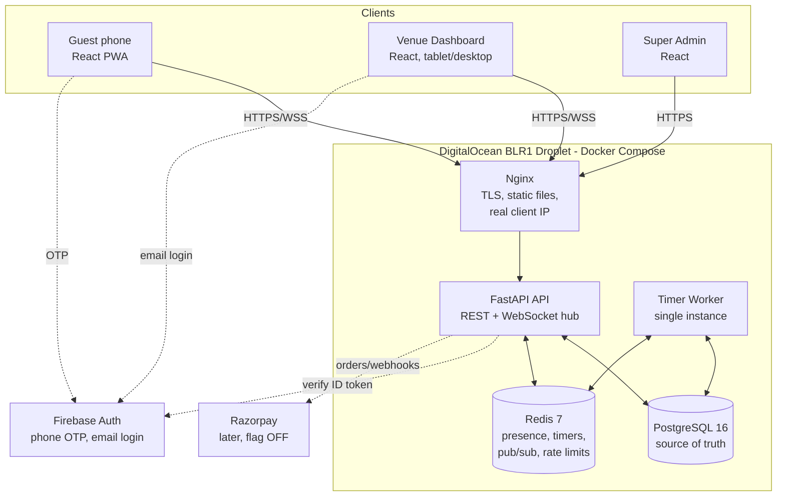
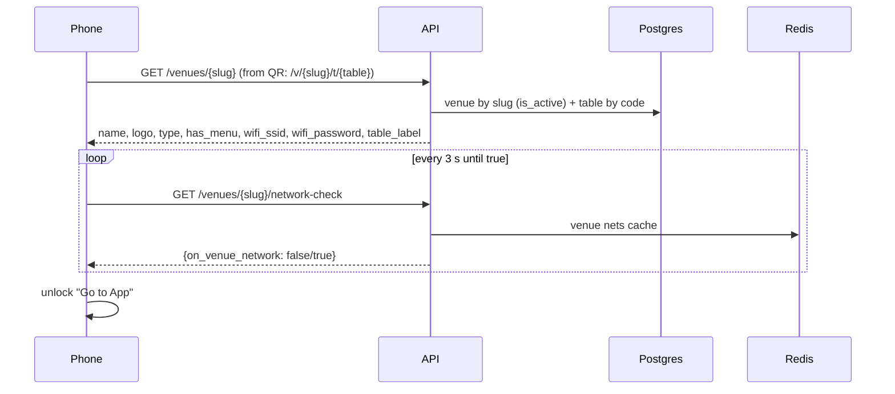
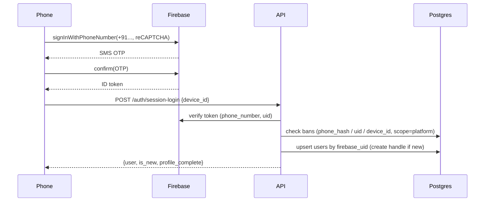
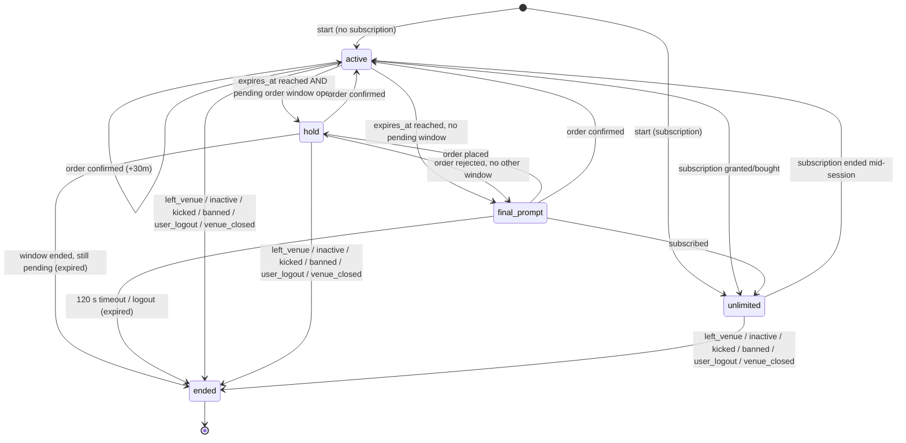
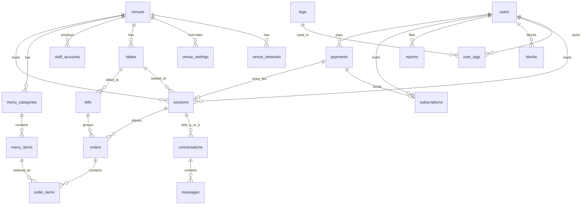

# IntroChat — Architecture, Data Flow & Database Schema

> **Audience:** developers building IntroChat.
> **Date:** 2026-09-28 · **Status:** design, pre-development
> **Related docs:** [IDEA_AND_TECH_STACK.md](IDEA_AND_TECH_STACK.md) (what & why) · [IMPLEMENTATION_PLAN.md](IMPLEMENTATION_PLAN.md) (milestones, flags, API list)
> **Diagrams** use Mermaid. They render on GitHub. In VS Code, install the extension *"Markdown Preview Mermaid Support"*.

---

## Contents

1. [System architecture](#1-system-architecture)
2. [Cross-cutting rules](#2-cross-cutting-rules)
3. [Data flows (step by step)](#3-data-flows)
4. [State machines](#4-state-machines)
5. [Database schema (PostgreSQL)](#5-database-schema-postgresql)
6. [Redis data model](#6-redis-data-model)
7. [Background worker jobs](#7-background-worker-jobs)
8. [Concurrency & consistency rules](#8-concurrency--consistency-rules)
9. [Error codes](#9-error-codes)
10. [Data retention & privacy](#10-data-retention--privacy)
11. [Scaling path](#11-scaling-path)

---

## 1. System architecture

### 1.1 Component diagram



### 1.2 Responsibilities

| Component | Owns | Does NOT do |
|---|---|---|
| **React app** | UI, i18n (en/hi/gu), countdown display, heartbeat sender, WebSocket client, Firebase OTP UI | Deciding time, checking location, trusting its own clock |
| **Nginx** | TLS termination, serving the React build, proxying `/api` and `/ws`, setting `X-Forwarded-For` / `X-Real-IP` | Business logic |
| **FastAPI API** | All REST endpoints, WebSocket connections, auth verification, IP check, writes to Postgres, publishes events to Redis | Timed jobs (warnings, expiry). Only the worker runs those. |
| **Timer Worker** | Warnings, expiry, final prompt, pending-order notices/windows, offline detection, inactivity logout, cleanup jobs | Serving HTTP |
| **PostgreSQL** | Permanent truth: users, venues, sessions, chats, orders, bills, bans, payments | Live presence (too chatty) |
| **Redis** | Fast, rebuildable state: who is online, timer queues, pub/sub fan-out, rate-limit counters, caches | Anything that can't be rebuilt from Postgres |
| **Firebase Auth** | Phone OTP and email/password login, issuing ID tokens | Roles (roles live in our DB) |

### 1.3 Process model

| Process | Count (pilot) | Count (scale) | Command |
|---|---|---|---|
| `api` | 1 container, 2 uvicorn workers | N containers behind load balancer | `uvicorn app.main:app --proxy-headers --forwarded-allow-ips=<nginx>` |
| `worker` | **exactly 1** | exactly 1 (+ Redis lock for safety) | `python -m app.workers.timer_worker` |
| `redis`, `postgres`, `nginx` | 1 each | managed services | — |

**Why WebSockets need Redis pub/sub even with 2 uvicorn workers:** guest A's socket may live in worker 1 and guest B's in worker 2. Every event is published to Redis. Each API process subscribes and forwards the event to the sockets **it** holds.

### 1.4 Trust boundaries

```
 UNTRUSTED                              TRUSTED
 ─────────────────────────────┬──────────────────────────────────────
 Phone browser (any input,    │ Nginx → API → Postgres/Redis/Worker
 any clock, any header)       │
                              │ Trust rules:
                              │  • Identity  = Firebase ID token verified server-side
                              │  • Location  = client IP as set by OUR nginx only
                              │  • Time      = server UTC clock only
                              │  • Role      = staff_accounts row, never a client claim
                              │  • Prices    = menu_items row, never the client's cart price
```

---

## 2. Cross-cutting rules

### 2.1 Authentication

- Every REST call sends `Authorization: Bearer <Firebase ID token>`. The WebSocket passes the token as `?token=` on connect.
- `firebase_admin.auth.verify_id_token(token, check_revoked=False)` checks it. The result is cached in Redis for 5 minutes as `authcache:{sha256(token)}`.
- **Guest vs staff** is decided by the token's `firebase.sign_in_provider`:
  - `phone` → guest endpoints only
  - `password` → staff endpoints only, **and** a row in `staff_accounts` with `is_active = true` is required
- FastAPI dependencies:
  - `current_guest` → returns `users` row. Creates it on first login (§3.2).
  - `current_session` → `current_guest` + their live session (status ≠ ended). Otherwise `409 SESSION_NOT_ACTIVE`.
  - `current_staff(roles=[...])` → `staff_accounts` row. For venue roles it also enforces `venue_id` scope.

### 2.2 Client IP resolution

```python
def client_ip(request) -> ipaddress.IPv4Address | IPv6Address:
    # uvicorn --proxy-headers already replaced request.client.host with the
    # left-most X-Forwarded-For value, ONLY IF the direct peer is nginx.
    return ipaddress.ip_address(request.client.host)
```

- Nginx: `proxy_set_header X-Forwarded-For $remote_addr;`. This **overwrites** the header and does not append to it, so a client-supplied header is thrown away.
- The domain has **no AAAA record**, so clients always reach us over IPv4.

### 2.3 Venue network check

```python
async def is_on_venue_network(ip, venue_id) -> bool:
    if not settings.VENUE_IP_CHECK_ENABLED:          # dev only
        return True
    cidrs = await cache.get_or_load(f"venue:nets:{venue_id}", ttl=60,
                                    loader=lambda: db.venue_network_cidrs(venue_id))
    return any(ip in ipaddress.ip_network(c) for c in cidrs)
```

It is called at:
1. `GET /venues/{slug}/network-check`
2. `POST /sessions`
3. `POST /presence/heartbeat`
4. WebSocket connect

### 2.4 Feature-flag resolution

```python
async def flag(key: str, venue_id: UUID | None):
    if venue_id:
        v = await cache.get_or_load(f"venue:settings:{venue_id}", ttl=60,
                                    loader=lambda: db.venue_settings(venue_id))
        if key in v: return v[key]
    return getattr(settings, key)        # env default
```

When the admin changes a venue setting, the cache key is deleted immediately.

### 2.5 Time, money, IDs, text

| Concern | Rule |
|---|---|
| Time | All DB times `timestamptz`, stored UTC. The server sends `server_now` with every session payload so the phone can correct for clock drift: `offset = server_now - Date.now()`. |
| Local dates | Revenue per "day" uses the venue's `timezone` (default `Asia/Kolkata`). |
| Money | Integer **paise** everywhere (`₹19 = 1900`). No floats. |
| IDs | `UUID` (`gen_random_uuid()`) for entities; `BIGINT GENERATED ALWAYS AS IDENTITY` for high-volume append-only rows (messages, audit_log). |
| Text | UTF-8 end to end. Chat body max 1000 chars after trimming. Reject strings that are only whitespace. |
| Enums | Stored as `TEXT` + `CHECK (col IN (...))`, not Postgres native enums, because Alembic migrations of native enums are painful. |

### 2.6 Messages to the user are codes

The server never sends sentences. It sends codes, e.g. `{"code": "SESSION_ENDED", "reason": "left_venue"}`. The React app translates them with `t('errors.SESSION_ENDED.left_venue')` into en/hi/gu.

### 2.7 Rate limits (Redis fixed-window counters)

| Key | Limit |
|---|---|
| network-check per IP | 60 / min |
| session start per user | 10 / hour |
| heartbeat per session | 6 / min |
| chat send per session | 20 / 10 s |
| new conversations per session | 30 / hour |
| orders per session | 10 / hour, max 3 pending at once |
| reports per user | 5 / day |

Exceeding a limit → `429 RATE_LIMITED` with `retry_after` seconds.

---

## 3. Data flows

Each flow lists: **trigger → steps → writes → events emitted → failure cases.**

### 3.1 QR scan → landing → network check



Logic:
1. Venue inactive / slug unknown → `404 VENUE_NOT_FOUND` → "This QR code is not active" page.
2. Table code unknown or inactive → still load the venue, set `table=null`, and show "Ask staff for a new QR". Chat works, but ordering is blocked until a valid table.
3. The WiFi password is decrypted server-side and returned. It is shown with a **Copy** button.
4. After 60 s of polling with no success, show the help panel ("Turned off mobile data? VPN or iCloud Private Relay on?").
5. The table code is stored in `sessionStorage` so it survives the login redirect.

### 3.2 Login (phone OTP) → user record → permanent handle



Logic:
```python
phone_hash = hmac_sha256(settings.PHONE_HASH_SECRET, e164_phone)
if active_platform_ban(phone_hash, uid, device_id): raise 403 BANNED
user = get_user_by_uid(uid)
if not user:
    for _ in range(5):
        handle = f"{random.choice(HANDLE_WORDS)}-{random.randint(0, 9999):04d}"
        try:
            user = insert_user(uid, phone_hash, handle, device_id); break
        except UniqueViolation on handle: continue
    else: raise 500 HANDLE_GENERATION_FAILED
user.last_device_id = device_id
```

- `device_id` = random UUID created by the browser on first visit and kept in `localStorage`. It is a weak signal, used only for bans.
- If the same phone logs in on a new phone, it is the same Firebase uid, so the same user and the **same handle**.
- The raw phone number is **never stored** by us. Firebase keeps it.

### 3.3 Profile & tags

1. `PUT /me/profile {nickname?, birth_year?, gender?, preferred_language}`. All optional except language.
2. `GET /tags/suggestions?venue={slug}&q=foo`:
   - `ZREVRANGE tags:venue:{venue_id} 0 19` → popular at this venue now
   - `+` top 20 global tags by `usage_count` (from `tags` table)
   - filtered by prefix `q`, de-duplicated, blocked tags removed
3. `PUT /me/tags {tags: ["Football", "music"]}`:
   ```python
   names = unique(normalise(t) for t in tags)[:MAX_TAGS_PER_USER]
   # normalise: NFC, strip, lower(), collapse spaces, 1..24 chars,
   #            allowed = letters/digits/space in any script (\w and space)
   reject if any name in BAD_WORDS or tag.is_blocked → 422 TAG_NOT_ALLOWED
   upsert tags; replace user_tags (in one transaction)
   if user has live session: update Redis tag counts (−old, +new) and
      publish people.updated to the venue
   ```

### 3.4 Start session

```mermaid
sequenceDiagram
  participant P as Phone
  participant API
  participant PG as Postgres
  participant R as Redis
  P->>API: POST /sessions {venue_slug, table_code, device_id}
  API->>API: IP check
  API->>PG: BEGIN; bans (platform + venue kick cooldown)
  API->>PG: existing live session? (FOR UPDATE)
  API->>PG: subscription active? / scan fee paid?
  API->>PG: INSERT sessions; COMMIT
  API->>R: presence add, timers add, tag counts, session hash
  API->>R: PUBLISH venue channel: presence.joined
  API-->>P: session payload + server_now
```

Logic (inside one DB transaction):
```python
venue = active_venue(slug) or 404 VENUE_NOT_FOUND
table = venue_table(venue, table_code)                 # may be None
if not await is_on_venue_network(ip, venue.id):  raise 403 NOT_ON_VENUE_NETWORK
if platform_ban(user) or venue_ban(user, venue): raise 403 BANNED / KICKED_COOLDOWN(until)
if not user.profile_has_min_fields():            raise 409 PROFILE_INCOMPLETE  # >=1 tag

live = select session where user_id=user.id and status != 'ended' FOR UPDATE
if live and live.venue_id == venue.id:
    return live                                   # resume (page refresh, reconnect)
if live:
    end_session(live, 'left_venue')               # was at another venue

if subscription_active(user):
    status, expires_at = 'unlimited', None
else:
    if flag('SCAN_FEE_ENABLED', venue.id):
        pay = unused_paid_scan_fee(user, within=30 min) or raise 402 PAYMENT_REQUIRED
    status, expires_at = 'active', now + minutes(flag('SESSION_MINUTES', venue.id))

session = insert sessions(user, venue, table, status, started_at=now, expires_at,
                          entry_payment_id=pay?.id, device_id, start_ip=ip)
```
After commit (Redis side effects, §6):
- `ZADD presence:venue:{v} now session_id`
- `HSET session:{id} ...`
- `ZADD timers:warn (expires_at - 5min)`, `ZADD timers:expire expires_at` (only if not unlimited)
- `ZINCRBY tags:venue:{v} 1 tag` for each user tag
- `PUBLISH venue:{v} presence.joined {session_id, handle, tags}`

**Uniqueness guarantee:** partial unique index `one_live_session_per_user` (§5). If two tabs race, one insert fails. We catch it and return the existing session.

### 3.5 WebSocket connect

1. `wss://.../ws?token=...` → verify token → guest or staff.
2. Guest: require a live session, **IP check**, else close with code `4403` (reason code in the close message).
3. Register the socket in the process-local map `session_id → set[WebSocket]` (multiple tabs allowed).
4. Subscribe (once per process) to `ws:session:{id}` and `ws:venue:{venue_id}`.
5. Mark presence online, as if a heartbeat arrived (§3.6).
6. Send `hello {session, server_now, flags}`.
7. The client re-syncs: `GET /people`, `GET /conversations` (which include unread counts).
8. Disconnect → unregister. We do **not** mark offline on disconnect; offline is decided only by missing heartbeats, because sockets drop on screen lock.

Staff socket: subscribe to `ws:dashboard:{venue_id}`.

### 3.6 Heartbeat & presence

```python
POST /presence/heartbeat                       # every 30 s, also on page focus
s = current_session
if not await is_on_venue_network(ip, s.venue_id):
    end_session(s, 'left_venue'); return 409 SESSION_ENDED(left_venue)
ZADD presence:venue:{v} now s.id
if SREM presence:offline:{v} s.id == 1:        # was offline
    PUBLISH venue: presence.online {session_id}
return {status, effective_end_at, server_now}
```

The worker (every 5 s, §7) handles:
- last_seen < now − 90 s and not in the offline set → `SADD offline`, publish `presence.offline`
- last_seen < now − 600 s → `end_session(s, 'inactive')`

Client rules:
- Send a heartbeat every 30 s while `document.visibilityState === 'visible'`, **and immediately** on `visibilitychange → visible` and on `online` events.
- A heartbeat response of `SESSION_ENDED` → go to the ended screen.

### 3.7 People list

```sql
-- live sessions at my venue, excluding me and blocks in either direction
SELECT s.id AS session_id, u.handle, s.started_at, array_agg(t.name) AS tags
FROM sessions s
JOIN users u        ON u.id = s.user_id
LEFT JOIN user_tags ut ON ut.user_id = u.id
LEFT JOIN tags t    ON t.id = ut.tag_id AND NOT t.is_blocked
WHERE s.venue_id = :venue AND s.status <> 'ended' AND s.id <> :me
  AND NOT EXISTS (SELECT 1 FROM blocks b
                  WHERE (b.blocker_user_id = :my_user AND b.blocked_user_id = u.id)
                     OR (b.blocker_user_id = u.id AND b.blocked_user_id = :my_user))
GROUP BY s.id, u.handle, s.started_at;
```
Then in Python:
- `online = session_id not in SMEMBERS presence:offline:{v}`
- `shared = my_tags ∩ tags`
- sort by `(not online, -len(shared), -started_at)`

Response per card: `{session_id, handle, tags, shared_tags, online}`. **Never** user_id, nickname, age, gender or phone.

Live updates (the client patches its list): `presence.joined`, `presence.left`, `presence.offline`, `presence.online`, `people.updated` (tags changed), `people.removed` (block).

### 3.8 Chat: send, deliver, seen

```mermaid
sequenceDiagram
  participant A as Guest A
  participant API
  participant PG as Postgres
  participant R as Redis
  participant B as Guest B
  A->>API: WS chat.send {to_session_id | conversation_id, body, client_msg_id}
  API->>API: validate (live, same venue, not blocked, rate limit, length)
  API->>PG: upsert conversation (a<b); INSERT message
  API->>R: PUBLISH ws:session:B chat.message
  API-->>A: chat.ack {client_msg_id, message_id, created_at}
  R-->>B: chat.message (via B's API process)
  B->>API: WS chat.seen {conversation_id, up_to_message_id}
  API->>PG: UPDATE messages SET seen_at=now WHERE ... <= id AND seen_at IS NULL
  API->>R: PUBLISH ws:session:A chat.seen
```

Validation, in order:
1. Sender session live
2. Recipient session exists, `status <> 'ended'`, **same venue**
3. No block either way → `403 BLOCKED`
4. Body 1..1000 chars → `422 MESSAGE_INVALID`
5. Rate limit → `429`

Conversation upsert:
```sql
INSERT INTO conversations (venue_id, session_a_id, session_b_id)
VALUES (:v, LEAST(:s1,:s2), GREATEST(:s1,:s2))
ON CONFLICT (session_a_id, session_b_id) DO UPDATE SET last_message_at = now()
RETURNING id;
```

- **Offline recipient:** the message is stored anyway. When B returns, `GET /conversations` shows the unread count and `GET /conversations/{id}/messages?after=<last_id>` fetches what was missed.
- **Idempotency:** `client_msg_id` (UUID from the phone) is unique per sender session. A retried send returns the original ack and does not duplicate.
- **Typing:** `chat.typing` is relayed via Redis only. Nothing is stored. The client throttles it to once per 3 s.

### 3.9 Session end (the single exit path)

Every exit goes through `end_session(session, reason)`: expiry, logout, left_venue, inactive, kicked, banned, venue_closed.

```python
def end_session(session_id, reason):
    with db.begin():
        s = select sessions where id=:id FOR UPDATE
        if s.status == 'ended': return              # idempotent
        s.status, s.ended_at, s.end_reason = 'ended', now, reason
        partner_ids = select other side of conversations of s
        delete conversations where s in (a, b)       # messages cascade
    # after commit — Redis & events (safe to repeat)
    ZREM presence:venue:{v} s.id ; SREM presence:offline:{v} s.id
    ZREM timers:warn/expire/final s.id
    ZINCRBY tags:venue:{v} -1 each tag (remove members that reach 0)
    DEL session:{s.id}
    PUBLISH ws:session:{s.id}  session.ended {reason}
    PUBLISH ws:venue:{v}       presence.left {session_id}
    for p in partner_ids: PUBLISH ws:session:{p} chat.conversation_closed {session_id}
    PUBLISH ws:dashboard:{v}   guests.count
    close sockets of s (code 4000)
```

Not touched by `end_session`:
- **orders** and **bills**. They belong to the restaurant's records.
- **report evidence**. It was already copied into the report.

### 3.10 Timer: warning → choice → final prompt

**Effective end time:**
```
pending_windows = [o.placed_at + 15 min for o in session.orders if o.status == 'pending']
effective_end_at = max([s.expires_at] + pending_windows)     # None if unlimited
```

Worker ticks (details in §7):

| Timer | Fires at | Action |
|---|---|---|
| warn | expires_at − 5 min | `session.warning {effective_end_at, choices}` where choices = `order` (if venue has_menu) + `subscribe` (shows "coming soon" if flag off) + `not_now` |
| expire | expires_at | if a pending order window is open → status `hold`, `session.hold`; else → status `final_prompt`, `ZADD timers:final now+120s`, `session.final_prompt` |
| final | +120 s | `end_session(s, 'expired')` unless an order was placed / subscription started in between |

Guest actions during the popups:
- **Not now** → client-only, closes the popup. The server state is unchanged.
- **Order food** → the normal order flow (§3.11), which sets up the pending window.
- **Log out** → `POST /sessions/current/logout` → `end_session(s, 'user_logout')`.

### 3.11 Food order → confirm → extension

```mermaid
sequenceDiagram
  participant G as Guest
  participant API
  participant PG as Postgres
  participant R as Redis
  participant D as Venue Dashboard
  G->>API: POST /orders {items:[{menu_item_id, qty}], note}
  API->>PG: BEGIN; price from menu_items; INSERT orders(pending), order_items; COMMIT
  API->>R: ZADD timers:order_notice (+10m), timers:order_window (+15m)
  API->>R: PUBLISH dashboard: order.new
  API-->>G: order {status: pending, window_ends_at}
  Note over G: if session was in final_prompt → back to hold/active
  D->>API: POST /venue/orders/{id}/confirm
  API->>PG: BEGIN; lock order + session; order=confirmed; extend; attach to bill; COMMIT
  API->>R: reschedule timers; PUBLISH guest: order.updated + session.extended
  API-->>D: ok
```

**Place order:**
```python
s = current_session;  venue = s.venue
if not venue.has_menu:           raise 409 MENU_NOT_AVAILABLE
if s.table_id is None and venue.type != 'event': raise 409 TABLE_REQUIRED
if count_pending(s) >= MAX_PENDING_ORDERS_PER_SESSION: raise 429 TOO_MANY_PENDING_ORDERS
items = load menu_items where id in (...) and venue_id = venue.id and is_available
if any missing/unavailable:      raise 409 ITEM_UNAVAILABLE {item_ids}
qty 1..20 each; subtotal = sum(price_paise * qty)       # server prices only
insert orders(status='pending', placed_at=now, subtotal, commission_percent=venue.commission_percent,
              table_id=s.table_id, session_id=s.id, user_id=s.user_id)
insert order_items(name_snapshot, price_paise_snapshot, qty)
if s.status == 'final_prompt':  # ordered from the final popup
    s.status = 'hold'; ZREM timers:final s.id
```

**Confirm:**
```python
with db.begin():
    o = select orders where id=:id and venue_id=:staff_venue FOR UPDATE
    if o.status != 'pending': raise 409 ORDER_NOT_PENDING
    s = select sessions where id=o.session_id FOR UPDATE
    o.status, o.confirmed_at, o.confirmed_by_staff_id = 'confirmed', now, staff.id
    bill = get_or_create_open_bill(o.venue_id, o.table_id, o.session_id)   # §5 bills
    o.bill_id = bill.id; bill.total_paise += o.subtotal_paise
    if s.status in ('active','hold','final_prompt') and \
       o.subtotal_paise >= flag('MIN_ORDER_FOR_EXTENSION_PAISE', venue):
        s.expires_at = max(s.expires_at, now) + minutes(EXTENSION_MINUTES)
        s.status = 'active'; s.warning_sent_at = None
        o.extension_applied = True
# after commit
ZREM timers:order_notice/order_window o.id
if extension_applied: ZADD timers:warn, timers:expire (new times); ZREM timers:final
publish guest: order.updated, session.extended {effective_end_at}
audit_log('order.confirm')
```
If the session is already `ended`, the order is still confirmed and billed, with no extension.

**Reject:**
- `o.status = 'rejected'`, `reject_reason`, remove the order timers, publish `order.updated` to the guest.
- If the session is in `hold` and no other pending order window is open → status `final_prompt`, `ZADD timers:final now+120s`.

**Pending notice (worker, placed_at + 10 min, still pending):**
- guest ← `order.pending_notice {order_id, minutes_left: 5}`
- dashboard ← `order.overdue {order_id}`
- set `pending_notice_sent_at`

**Pending window end (worker, placed_at + 15 min, still pending):**
- The order **stays pending**. It is never auto-rejected.
- If `s.status == 'hold'` and `effective_end_at <= now` → `end_session(s, 'expired')`.

### 3.12 Bill

- **One open bill per table** (restaurants): all guests at Table 7 share it, like today's paper bill.
- Events with no table get one bill per session.
- Only **confirmed** orders are added.
- `POST /bill/request` → `bills.status = 'requested'`, `requested_at = now` → dashboard `bill.requested {table_label}`.
- Staff `POST /venue/bills/{id}/mark-paid {method: cash|upi|card}` → `status='paid'`, `paid_at`, `paid_marked_by_staff_id`. The next order at that table opens a new bill.

### 3.13 Block, report, kick, ban

**Block** `POST /blocks {target_session_id}`:
1. Resolve target session → target user (server-side; the client never sees user_id).
2. `INSERT blocks (blocker_user_id, blocked_user_id) ON CONFLICT DO NOTHING`.
3. Delete the conversation between the two live sessions (if any).
4. Publish `people.removed` to both, and `chat.conversation_closed` to both.

**Report** `POST /reports {target_session_id, reason, note}`:
1. Rate limit 5/day.
2. If `REPORT_EVIDENCE_ENABLED` → select the last 50 messages of their conversation → `evidence = [{from: 'reporter'|'reported', body, at}]`, `evidence_expires_at = now + 30 d`.
3. Insert the report (`status='open'`).
4. Perform **Block** (auto-block).

**Kick** (staff) `POST /venue/guests/{session_id}/kick {reason}`:
1. Session must belong to the staff's venue.
2. Insert `bans (scope='venue', venue_id, phone_hash, firebase_uid, expires_at = now + KICK_COOLDOWN_HOURS)`.
3. `end_session(s, 'kicked')`, audit log.
4. On rescan within 12 h → `403 KICKED_COOLDOWN {until}`.

**Ban** (admin) `POST /admin/bans {user_id or report_id, duration_days|permanent, reason}`:
1. Insert `bans (scope='platform', phone_hash, firebase_uid, device_id=user.last_device_id, expires_at)`.
2. End any live session with `banned`.
3. Optionally revoke Firebase refresh tokens.
4. Close the report as `actioned`.

**Ban check query:**
```sql
SELECT 1 FROM bans
WHERE (expires_at IS NULL OR expires_at > now())
  AND (scope = 'platform' OR (scope = 'venue' AND venue_id = :venue))
  AND (phone_hash = :ph OR firebase_uid = :uid OR device_id = :dev)
LIMIT 1;
```

### 3.14 Subscription (pilot: admin grant; later: purchase)

- **Grant:** `POST /admin/subscriptions {user_id, days}` → insert `subscriptions(source='admin_grant', starts_at=now, ends_at=now+days)`.
  - If the user has a live session: status `unlimited`, `expires_at = NULL`, `ZREM` all its timers, publish `session.extended {unlimited: true}`.
- **Purchase (flag ON):** see §3.15. On payment success → same as grant with `source='purchase'`, `payment_id`.
- **Stacking:** a new subscription starts at `max(now, current.ends_at)`.
- **Ends during a live session** (worker, daily + on heartbeat): status `active`, `expires_at = now + WARNING_BEFORE_MINUTES`, and the warning is sent immediately.

### 3.15 Payments (built, `PAYMENTS_ENABLED=false`)

```
1. POST /payments/{scan-fee|subscription}
      → INSERT payments(status='created', amount from config)
      → Razorpay Orders API (amount, receipt=payment.id) → store provider_order_id
      → return {razorpay_order_id, key_id, amount}
2. Phone opens Razorpay Checkout → user pays
3. POST /payments/verify {razorpay_order_id, razorpay_payment_id, razorpay_signature}
      → HMAC check → mark_paid()
4. Webhook payment.captured → signature check → mark_paid()   (whichever arrives first)
mark_paid(): UPDATE payments SET status='paid' ... WHERE id=:id AND status='created'
             → rowcount==0 means already processed (idempotent)
             → subscription: create subscriptions row; scan fee: available for POST /sessions
```

### 3.16 Venue onboarding (admin)

1. Create venue (slug, name, type, has_menu, commission %, timezone).
2. Add the static IP to `venue_networks`. A **Test** button runs a network check from a phone at the venue.
3. Set WiFi SSID + password (stored encrypted).
4. Create tables (bulk: "T01..T20") → download the QR PDF.
5. Invite the owner: admin enters an email → Firebase Admin creates the user and sends a password-set link → `staff_accounts(role='venue_owner')`.
6. Owner builds the menu in the Dashboard.
7. Set `is_active = true`.

---

## 4. State machines

### 4.1 Session


"Offline" is **not** a session status. It is a presence flag in Redis, independent of the status above.

### 4.2 Order
```
pending ──confirm──► confirmed        (terminal)
pending ──reject───► rejected         (terminal)
pending ──guest cancel (only while pending)──► cancelled (terminal)
```
Never auto-rejected.

### 4.3 Bill
```
open ──guest requests──► requested ──staff marks paid──► paid (terminal)
open ──staff marks paid──────────────────────────────► paid
```

### 4.4 Report
`open → actioned | dismissed`

### 4.5 Payment
`created → paid | failed`, `paid → refunded`

---

## 5. Database schema (PostgreSQL)

### 5.1 Conventions

- Every table has `created_at timestamptz NOT NULL DEFAULT now()`. Mutable tables also have `updated_at timestamptz NOT NULL DEFAULT now()`, set by SQLAlchemy `onupdate`.
- PK `id uuid DEFAULT gen_random_uuid()` unless stated.
- FK delete rules are stated per column. The default is `RESTRICT` (protects history).
- Enum-like columns = `text` + `CHECK`.
- Extensions: `pgcrypto` (UUIDs).
- Naming: tables plural snake_case. Indexes `ix_<table>_<cols>`, uniques `uq_...`, checks `ck_...`.

### 5.2 ER diagram



### 5.3 Tables

#### `venues`
| Column | Type | Null | Default | Notes |
|---|---|---|---|---|
| id | uuid | no | gen_random_uuid() | PK |
| slug | text | no | | `uq_venues_slug`; `^[a-z0-9-]{3,40}$` |
| name | text | no | | |
| type | text | no | | `ck`: restaurant, cafe, event |
| address | text | yes | | |
| city | text | yes | | |
| logo_url | text | yes | | |
| wifi_ssid | text | no | | |
| wifi_password_enc | text | yes | | Fernet-encrypted; NULL = open WiFi |
| has_menu | boolean | no | true | false for most events |
| commission_percent | numeric(5,2) | no | 0 | `ck` 0..100 |
| timezone | text | no | 'Asia/Kolkata' | |
| event_starts_at / event_ends_at | timestamptz | yes | | events only |
| is_active | boolean | no | false | Only active venues accept scans |

#### `venue_networks`
| Column | Type | Null | Notes |
|---|---|---|---|
| id | uuid | no | PK |
| venue_id | uuid | no | FK venues **CASCADE** |
| cidr | cidr | no | e.g. `49.36.12.5/32` |
| label | text | yes | "Airtel primary", "Jio backup" |

Index: `uq_venue_networks_venue_cidr (venue_id, cidr)`. The table is tiny and cached, so no GiST index is needed.

#### `venue_settings`
| Column | Type | Null | Notes |
|---|---|---|---|
| venue_id | uuid | no | FK venues CASCADE, PK part |
| key | text | no | PK part; must be a known flag name (validated in app) |
| value | jsonb | no | e.g. `240`, `true` |

#### `tables`
| Column | Type | Null | Notes |
|---|---|---|---|
| id | uuid | no | PK |
| venue_id | uuid | no | FK venues CASCADE |
| code | text | no | In QR URL, e.g. `T07`; `^[A-Za-z0-9]{1,8}$` |
| label | text | no | "Table 7" |
| is_active | boolean | no | default true |

`uq_tables_venue_code (venue_id, code)`

#### `staff_accounts`
| Column | Type | Null | Notes |
|---|---|---|---|
| id | uuid | no | PK |
| firebase_uid | text | no | `uq` |
| email | text | no | `uq` (lower-cased) |
| role | text | no | `ck`: super_admin, venue_owner, venue_staff |
| venue_id | uuid | yes | FK venues RESTRICT; `ck`: NULL iff role = super_admin |
| is_active | boolean | no | default true |

#### `users` (guests)
| Column | Type | Null | Notes |
|---|---|---|---|
| id | uuid | no | PK |
| firebase_uid | text | no | `uq` |
| phone_hash | text | no | `uq`; HMAC-SHA256 hex |
| handle | text | no | `uq`; fixed forever, e.g. `Mango-4821` |
| nickname | text | yes | private; ≤ 30 chars |
| birth_year | smallint | yes | `ck` 1900..current year |
| gender | text | yes | `ck`: male, female, other, prefer_not |
| preferred_language | text | no | default 'en'; `ck`: en, hi, gu |
| last_device_id | text | yes | |
| deleted_at | timestamptz | yes | account deletion request (§10) |

#### `tags`
| Column | Type | Null | Notes |
|---|---|---|---|
| id | uuid | no | PK |
| name | text | no | `uq`; normalised, 1..24 chars |
| usage_count | integer | no | default 0; maintained on user_tags change |
| is_blocked | boolean | no | default false |

#### `user_tags`
| Column | Type | Null | Notes |
|---|---|---|---|
| user_id | uuid | no | FK users CASCADE, PK part |
| tag_id | uuid | no | FK tags CASCADE, PK part |

Index `ix_user_tags_tag (tag_id)`

#### `sessions`
| Column | Type | Null | Notes |
|---|---|---|---|
| id | uuid | no | PK |
| user_id | uuid | no | FK users RESTRICT |
| venue_id | uuid | no | FK venues RESTRICT |
| table_id | uuid | yes | FK tables SET NULL |
| status | text | no | `ck`: active, hold, final_prompt, unlimited, ended |
| started_at | timestamptz | no | |
| expires_at | timestamptz | yes | NULL when unlimited |
| warning_sent_at | timestamptz | yes | reset on extension |
| ended_at | timestamptz | yes | |
| end_reason | text | yes | `ck`: expired, left_venue, inactive, kicked, banned, user_logout, venue_closed |
| entry_payment_id | uuid | yes | FK payments; `uq` (a fee pays for one session) |
| device_id | text | yes | |
| start_ip | inet | no | |

Indexes:
- `uq_sessions_one_live_per_user` **UNIQUE (user_id) WHERE status <> 'ended'**
- `ix_sessions_venue_live (venue_id) WHERE status <> 'ended'`
- `ix_sessions_user_started (user_id, started_at DESC)`

Check: `ck_sessions_ended`: `(status = 'ended') = (ended_at IS NOT NULL)`

#### `conversations`
| Column | Type | Null | Notes |
|---|---|---|---|
| id | uuid | no | PK |
| venue_id | uuid | no | FK venues |
| session_a_id | uuid | no | FK sessions CASCADE |
| session_b_id | uuid | no | FK sessions CASCADE |
| last_message_at | timestamptz | no | default now() |

- `ck_conversations_order`: `session_a_id < session_b_id`
- `uq_conversations_pair (session_a_id, session_b_id)`
- `ix_conversations_b (session_b_id)` (A is covered by the unique index)

#### `messages`
| Column | Type | Null | Notes |
|---|---|---|---|
| id | bigint identity | no | PK (monotonic → used for paging and "seen up to") |
| conversation_id | uuid | no | FK conversations **CASCADE** |
| sender_session_id | uuid | no | FK sessions CASCADE |
| client_msg_id | uuid | no | idempotency |
| body | text | no | `ck` char_length 1..1000 |
| seen_at | timestamptz | yes | |

- `uq_messages_sender_client (sender_session_id, client_msg_id)`
- `ix_messages_conv_id (conversation_id, id DESC)`

#### `menu_categories`
| Column | Type | Null | Notes |
|---|---|---|---|
| id | uuid | no | PK |
| venue_id | uuid | no | FK venues CASCADE |
| name | jsonb | no | `{"en":"Shakes","hi":"शेक","gu":"શેક"}` (en required) |
| sort_order | integer | no | default 0 |
| is_active | boolean | no | default true |

#### `menu_items`
| Column | Type | Null | Notes |
|---|---|---|---|
| id | uuid | no | PK |
| venue_id | uuid | no | FK venues CASCADE (denormalised for scoping) |
| category_id | uuid | no | FK menu_categories RESTRICT |
| name | jsonb | no | same i18n shape as category |
| description | jsonb | yes | |
| price_paise | integer | no | `ck` > 0 |
| is_veg | boolean | no | |
| image_url | text | yes | |
| is_available | boolean | no | default true (the "out of stock" toggle) |
| sort_order | integer | no | default 0 |
| deleted_at | timestamptz | yes | soft delete; old orders keep their snapshots |

Index `ix_menu_items_venue_cat (venue_id, category_id, sort_order)`

#### `bills`
| Column | Type | Null | Notes |
|---|---|---|---|
| id | uuid | no | PK |
| venue_id | uuid | no | FK venues |
| table_id | uuid | yes | FK tables; set for restaurants |
| session_id | uuid | yes | FK sessions SET NULL; set only when there is no table (events) |
| status | text | no | `ck`: open, requested, paid |
| total_paise | integer | no | default 0; sum of confirmed orders |
| requested_at | timestamptz | yes | |
| paid_at | timestamptz | yes | |
| payment_method | text | yes | `ck`: cash, upi, card |
| paid_marked_by_staff_id | uuid | yes | FK staff_accounts |

- `ck_bills_target`: `table_id IS NOT NULL OR session_id IS NOT NULL`
- `uq_bills_open_per_table (table_id) WHERE status <> 'paid'`
- `ix_bills_venue_status (venue_id, status)`

#### `orders`
| Column | Type | Null | Notes |
|---|---|---|---|
| id | uuid | no | PK |
| venue_id | uuid | no | FK venues |
| table_id | uuid | yes | FK tables SET NULL |
| session_id | uuid | no | FK sessions RESTRICT |
| user_id | uuid | no | FK users RESTRICT |
| bill_id | uuid | yes | FK bills; set on confirm |
| status | text | no | `ck`: pending, confirmed, rejected, cancelled |
| placed_at | timestamptz | no | |
| note | text | yes | ≤ 200 chars ("less sugar") |
| subtotal_paise | integer | no | `ck` > 0 |
| commission_percent | numeric(5,2) | no | copied from venue at placement |
| extension_applied | boolean | no | default false |
| pending_notice_sent_at | timestamptz | yes | |
| confirmed_at / rejected_at / cancelled_at | timestamptz | yes | |
| reject_reason | text | yes | |
| confirmed_by_staff_id | uuid | yes | FK staff_accounts |

- `ix_orders_venue_status_placed (venue_id, status, placed_at DESC)` (dashboard queue)
- `ix_orders_session_pending (session_id) WHERE status = 'pending'`
- `ix_orders_venue_confirmed (venue_id, confirmed_at) WHERE status = 'confirmed'` (revenue)

#### `order_items`
| Column | Type | Null | Notes |
|---|---|---|---|
| id | uuid | no | PK |
| order_id | uuid | no | FK orders CASCADE |
| menu_item_id | uuid | yes | FK menu_items SET NULL |
| name_snapshot | jsonb | no | name at order time |
| price_paise_snapshot | integer | no | price at order time |
| quantity | smallint | no | `ck` 1..20 |

#### `blocks`
| Column | Type | Null | Notes |
|---|---|---|---|
| blocker_user_id | uuid | no | FK users CASCADE, PK part |
| blocked_user_id | uuid | no | FK users CASCADE, PK part |

- `ck_blocks_not_self`
- `ix_blocks_blocked (blocked_user_id)` for the reverse lookup

#### `reports`
| Column | Type | Null | Notes |
|---|---|---|---|
| id | uuid | no | PK |
| reporter_user_id | uuid | no | FK users |
| reported_user_id | uuid | no | FK users |
| venue_id | uuid | no | FK venues |
| reason | text | no | `ck`: harassment, spam, inappropriate, other |
| note | text | yes | ≤ 500 chars |
| evidence | jsonb | yes | last 50 messages (if flag on); set NULL on expiry |
| evidence_expires_at | timestamptz | yes | |
| status | text | no | `ck`: open, actioned, dismissed |
| reviewed_by_staff_id | uuid | yes | FK staff_accounts |
| reviewed_at | timestamptz | yes | |

`ix_reports_status_created (status, created_at)`

#### `bans`
| Column | Type | Null | Notes |
|---|---|---|---|
| id | uuid | no | PK |
| scope | text | no | `ck`: platform, venue |
| venue_id | uuid | yes | `ck`: required iff scope = venue |
| phone_hash | text | yes | |
| firebase_uid | text | yes | |
| device_id | text | yes | |
| reason | text | no | e.g. `kick`, `report:<id>` |
| expires_at | timestamptz | yes | NULL = permanent |
| created_by_staff_id | uuid | no | FK staff_accounts |
| lifted_at | timestamptz | yes | manual unban |

- `ck_bans_identifier`: at least one of phone_hash / firebase_uid / device_id
- Indexes on each of `phone_hash`, `firebase_uid`, `device_id` (`WHERE lifted_at IS NULL`)

#### `payments`
| Column | Type | Null | Notes |
|---|---|---|---|
| id | uuid | no | PK (also Razorpay `receipt`) |
| user_id | uuid | no | FK users |
| purpose | text | no | `ck`: scan_fee, subscription |
| venue_id | uuid | yes | venue where bought (scan fee) |
| amount_paise | integer | no | `ck` > 0 |
| currency | text | no | 'INR' |
| provider | text | no | 'razorpay' |
| provider_order_id | text | yes | `uq` |
| provider_payment_id | text | yes | `uq` |
| status | text | no | `ck`: created, paid, failed, refunded |
| paid_at | timestamptz | yes | |
| raw_webhook | jsonb | yes | |

#### `subscriptions`
| Column | Type | Null | Notes |
|---|---|---|---|
| id | uuid | no | PK |
| user_id | uuid | no | FK users |
| starts_at / ends_at | timestamptz | no | `ck` ends_at > starts_at |
| source | text | no | `ck`: purchase, admin_grant |
| payment_id | uuid | yes | FK payments, `uq` |
| granted_by_staff_id | uuid | yes | FK staff_accounts |

`ix_subscriptions_user_ends (user_id, ends_at DESC)`. Active = `starts_at <= now() < ends_at`.

#### `audit_log`
| Column | Type | Null | Notes |
|---|---|---|---|
| id | bigint identity | no | PK |
| actor_type | text | no | `ck`: staff, guest, system |
| actor_id | uuid | yes | |
| action | text | no | e.g. `order.confirm`, `guest.kick`, `ban.create`, `setting.update` |
| target_type / target_id | text / uuid | yes | |
| venue_id | uuid | yes | |
| meta | jsonb | yes | |

`ix_audit_venue_created (venue_id, created_at DESC)`

### 5.4 Migration order (Alembic)

1. `0001_extensions_and_venues`: pgcrypto, venues, venue_networks, venue_settings, tables, staff_accounts
2. `0002_users_tags`
3. `0003_payments_subscriptions` (sessions reference payments)
4. `0004_sessions`
5. `0005_chat`: conversations, messages
6. `0006_menu_orders_bills`
7. `0007_safety`: blocks, reports, bans
8. `0008_audit_log`

A seed script (not a migration) inserts the demo venue, 5 tables, a sample menu, and one super admin.

---

## 6. Redis data model

| Key | Type | Value / member | Set by | Cleared by |
|---|---|---|---|---|
| `presence:venue:{v}` | ZSET | session_id → last_seen (epoch s) | session start, heartbeat, WS connect | end_session |
| `presence:offline:{v}` | SET | session_id | worker | heartbeat, end_session |
| `session:{id}` | HASH | user_id, venue_id, handle, status, expires_at, tags(json) | session start, status changes | end_session |
| `timers:warn` | ZSET | session_id → epoch | start, extension | fire, end_session, unlimited |
| `timers:expire` | ZSET | session_id → epoch | start, extension | fire, end_session, unlimited |
| `timers:final` | ZSET | session_id → epoch | expire → final_prompt | fire, order placed, end_session |
| `timers:order_notice` | ZSET | order_id → placed+10m | place order | fire, confirm/reject/cancel |
| `timers:order_window` | ZSET | order_id → placed+15m | place order | fire, confirm/reject/cancel |
| `tags:venue:{v}` | ZSET | tag name → live count | start, tag edit | end_session, tag edit |
| `venue:nets:{v}` | STRING json | CIDR list | cache load (60 s TTL) | admin edit |
| `venue:settings:{v}` | STRING json | overrides | cache load (60 s TTL) | admin edit |
| `authcache:{sha256}` | STRING json | verified token claims | auth (300 s TTL) | TTL |
| `rl:{scope}:{id}:{window}` | STRING int | counter | INCR + EXPIRE | TTL |
| `worker:lock` | STRING | instance id | worker (SET NX PX 10000, renewed) | TTL |
| pub/sub `ws:session:{id}` | channel | guest events | API, worker | — |
| pub/sub `ws:venue:{v}` | channel | presence / people events | API, worker | — |
| pub/sub `ws:dashboard:{v}` | channel | staff events | API, worker | — |

**Rebuild on worker start** (Redis wiped / first boot), for each session with `status <> 'ended'`:
- `presence` = now (gives everyone a fresh 10 min)
- `session` hash
- warn/expire timers from `expires_at`
- final timer = now + 120 s if in `final_prompt`
- order timers from pending orders
- tag counts

---

## 7. Background worker jobs

Loop every **2 s** (timers) / **5 s** (presence) / **hourly** (cleanup). Worker behaviour:
- Holds `worker:lock`. If it can't renew the lock, it stops processing.
- Each due item is popped with `ZRANGEBYSCORE key -inf now LIMIT 0 100`, then processed inside a DB transaction that **re-reads and re-checks** the row, because the state may have changed since scheduling. Then it is removed with `ZREM`.

| Job | Re-check before acting | Action |
|---|---|---|
| warn | status ∈ (active), `warning_sent_at IS NULL`, `expires_at − now ≤ 5m + 2s` | set warning_sent_at, publish `session.warning` |
| expire | status = active, `expires_at ≤ now` | open pending window → `hold` + `session.hold`; else `final_prompt` + timers:final + `session.final_prompt` |
| final | status = final_prompt, no pending order | `end_session('expired')` |
| order_notice | order.status = pending | set pending_notice_sent_at, publish guest + dashboard |
| order_window | order.status = pending | if session hold and `effective_end_at ≤ now` → `end_session('expired')` |
| presence offline | last_seen < now − 90 s, not in offline set | SADD, publish `presence.offline` |
| presence inactive | last_seen < now − 600 s | `end_session('inactive')` |
| subscription end | session unlimited, no active subscription | → active, expires_at = now + 5 m, warn now |
| event end | event venue with `event_ends_at < now` | `end_session('venue_closed')` for all its sessions |
| evidence cleanup (hourly) | `evidence_expires_at < now` | `evidence = NULL` |
| orphan chat cleanup (hourly) | conversations whose sessions are both ended | delete (safety net) |
| stale created payments (hourly) | status=created older than 24 h | status = failed |

---

## 8. Concurrency & consistency rules

| Race | Rule |
|---|---|
| Order confirm vs session expiry at the same second | Both paths `SELECT ... FOR UPDATE` the **session** row. Whoever gets the lock second re-checks the status and acts on the new state. |
| Two tabs start a session | Partial unique index `uq_sessions_one_live_per_user`; loser returns the existing session. |
| Two staff confirm the same order | `FOR UPDATE` on the order + `status = 'pending'` check → second gets `409 ORDER_NOT_PENDING`. |
| Two bills opened for one table | Partial unique index `uq_bills_open_per_table`; `get_or_create` retries a select on conflict. |
| Duplicate chat send (retry) | `uq_messages_sender_client`. |
| Webhook + verify both mark paid | Conditional `UPDATE ... WHERE status = 'created'`. |
| Redis side-effects after DB commit fail | Postgres stays correct; the worker's rebuild/cleanup jobs repair Redis. All Redis ops are idempotent (ZADD/ZREM/SREM). |
| Lock ordering (avoid deadlocks) | Always lock **session → order → bill**, in that order. |

---

## 9. Error codes

HTTP status + `{"code": "...", "details": {...}}`. The frontend maps each code to en/hi/gu text.

| Code | HTTP | When |
|---|---|---|
| VENUE_NOT_FOUND | 404 | slug unknown / inactive |
| NOT_ON_VENUE_NETWORK | 403 | IP check failed |
| BANNED | 403 | platform ban |
| KICKED_COOLDOWN | 403 | venue ban, `details.until` |
| PROFILE_INCOMPLETE | 409 | no tags |
| PAYMENT_REQUIRED | 402 | scan fee on, not paid |
| SESSION_NOT_ACTIVE | 409 | no live session |
| SESSION_ENDED | 409 | `details.reason` |
| BLOCKED | 403 | chat with blocked user |
| MESSAGE_INVALID | 422 | empty / too long |
| TAG_NOT_ALLOWED | 422 | bad word / blocked tag |
| MENU_NOT_AVAILABLE | 409 | venue has no menu |
| TABLE_REQUIRED | 409 | restaurant order without table |
| ITEM_UNAVAILABLE | 409 | `details.item_ids` |
| TOO_MANY_PENDING_ORDERS | 429 | > 3 pending |
| ORDER_NOT_PENDING | 409 | confirm/reject twice |
| FEATURE_DISABLED | 409 | flag off (e.g. payments) |
| FORBIDDEN_VENUE | 403 | staff touching another venue |
| RATE_LIMITED | 429 | `details.retry_after` |

WebSocket close codes: `4000` session ended, `4401` bad token, `4403` not on venue network / banned.

---

## 10. Data retention & privacy

| Data | Kept for | Deleted how |
|---|---|---|
| Chat messages | Until either session ends | `end_session` + hourly safety net |
| Report evidence | 30 days (if Q5 = yes) | hourly job sets NULL |
| Phone number | Never stored by us | Firebase only; we keep an HMAC |
| Sessions (metadata) | 1 year (analytics, abuse history) | yearly purge job (later) |
| Orders, bills | 8 years (Indian accounting norms; confirm with CA) | — |
| Audit log | 2 years | purge job (later) |
| Account deletion request | Profile cleared within 30 days | `deleted_at` set → nickname/birth_year/gender/tags wiped. Handle kept as "Deleted-xxxx". phone_hash kept **only if** a ban exists. |

**DPDP Act 2023 (India):** show a consent checkbox + privacy notice at first login, stating that we collect the phone number for login and safety, and interests for matching. The privacy policy text needs legal review before the pilot.

---

## 11. Scaling path

| Stage | Load | Change |
|---|---|---|
| Pilot | 1–5 cafes, ~30 users each | 1 Droplet, everything in Docker Compose |
| Growth | 50 venues, ~1,500 concurrent | Managed Postgres + Managed Redis; 2 API Droplets behind a DO Load Balancer (sticky sessions not required, thanks to pub/sub) |
| Navratri | 2,000+ in **one** venue | People list paginated (`?cursor=`) + search/filter by tag; `presence.*` events batched every 2 s per venue instead of one per change; load test at 3,000 sockets; the venue's WiFi hardware is the likely bottleneck, not our servers |
